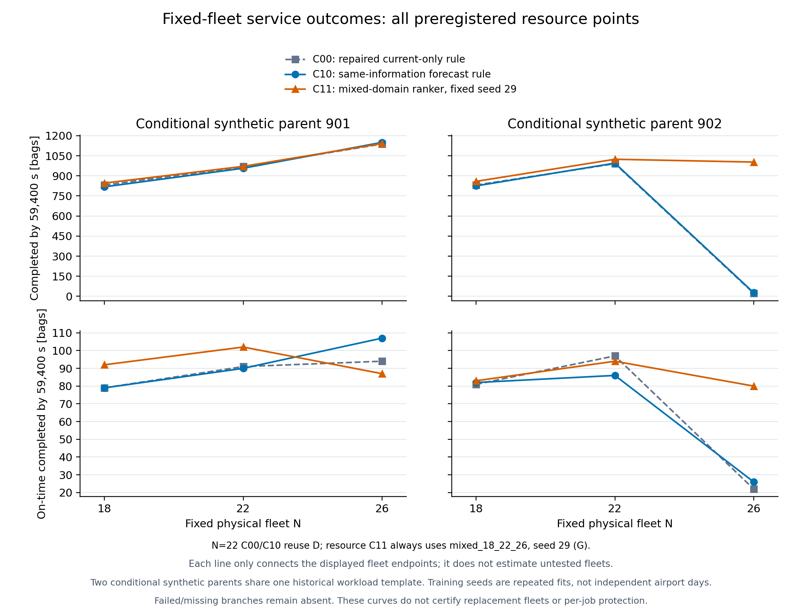

# G31 机场空盘动作价值实验：2026-10-20

本报告对应 `codex/g31-ics-v3-circulation` 的新实验周期
`outputs/experiments/g31_ics_action_value_20261020/cycle_001`。
科学历史锚点为 `13cf8eeb9e9692eaf9eaf8b2ebbaeee8e1001626`，
开工提交为仅增加审阅文档的 `41b27dbe70d629239ff150a721691d98421e98ae`。
用户要求继续 GPT Pro 的下一阶段实验，并尽快识别提前调度的运行价值。

## 本轮结论

本轮完成全部预登记实验与原始结果审计。最值得继续验证的提升点是：
**提前改变空盘分布并改善后续周转，使策略轨迹避开规则控制中出现的长期停滞。**
26盘、父组902的同信息强规则仅完成27件，混合资源学习策略完成1003件，
J降低17780947.891件·秒（3.511769378%）。两种规则后半程约10小时没有物理边推进，
学习策略持续推进到终点。这是一个固定资源点的整策略对照，不能外推为一般
3.5%的RL收益，也不能把全部差异归因于首次提前调度。

另一个可重复于本轮两个条件场景的信号是混合资源模型在18/22盘下的同信息
积压成本和完成/准时指标改善，但仍存在逐件延误、未知终局及部分隔离故障。
22盘主模型的完整三种子检验平均只改善0.089645688%，第二父组平均略差，
未显示稳定优势。直接的到达前同包等盘节省只在无预测C01中发现两例。
因此本轮证明了真实学习控制和部分运行价值，尚未证明预测提前调度的稳健净收益、
完整G2、逐件不退化接管或减盘替代。

## 22盘主检验的完整结果

修复共同循环后，预测学习相对同信息强规则的六格描述均值为
438744.142件·秒，相对改善的算术均值为0.089645688%。
父组901三种子均值改善882445.922件·秒（0.180305235%），
父组902三种子均值恶化4957.637件·秒（−0.001013860%）。
因此本轮没有达到测试前冻结的“平均相对改善至少0.1%、两个父组都改善、
没有新增失败”的扩大计算投入条件。该工程条件不是统计显著性，也不是G2定义。

以下全部16条分支到达共同59400秒端点。J的单位为件·秒，未完成业务仍进入积分；
到达量在父组901为20921件、父组902为20919件，完整offered均为28506件。

| 父组 | 策略 | J | 完成 | 准时 |
|---:|---|---:|---:|---:|
| 901 | C00 | 489185556.281640 | 969 | 91 |
| 901 | C10 | 489417802.811640 | 957 | 90 |
| 901 | C01 seed17 | 489473999.692640 | 948 | 90 |
| 901 | C01 seed29 | 488966066.575640 | 968 | 100 |
| 901 | C01 seed43 | 487903183.749640 | 1039 | 97 |
| 901 | C11 seed17 | 488263319.957640 | 1039 | 89 |
| 901 | C11 seed29 | 487974953.334640 | 1032 | 95 |
| 901 | C11 seed43 | 489367797.377640 | 993 | 70 |
| 902 | C00 | 488613207.456495 | 991 | 97 |
| 902 | C10 | 488986329.618495 | 995 | 86 |
| 902 | C01 seed17 | 488801995.698495 | 995 | 92 |
| 902 | C01 seed29 | 488275639.627495 | 1007 | 102 |
| 902 | C01 seed43 | 488722550.677495 | 1014 | 69 |
| 902 | C11 seed17 | 489043401.923495 | 997 | 80 |
| 902 | C11 seed29 | 488915414.363495 | 977 | 81 |
| 902 | C11 seed43 | 489015045.480495 | 1007 | 78 |

每格均单独重算全人口和共同热身/源码绑定。下表正值表示候选降低成本；
交互为`[J(C10)−J(C11)]−[J(C00)−J(C01)]`。

| 父组/seed | C11对C10改善 | C11对C00改善 | C01对C00改善 | 交互 |
|---|---:|---:|---:|---:|
| 901/17 | 1154482.854 | 922236.324 | −288443.411 | 1442926.265 |
| 901/29 | 1442849.477 | 1210602.947 | 219489.706 | 1223359.771 |
| 901/43 | 50005.434 | −182241.096 | 1282372.532 | −1232367.098 |
| 902/17 | −57072.305 | −430194.467 | −188788.242 | 131715.937 |
| 902/29 | 70915.255 | −302206.907 | 337567.829 | −266652.574 |
| 902/43 | −28715.862 | −401838.024 | −109343.221 | 80627.359 |

C10本身相对C00在两个父组分别恶化232246.530与373122.162件·秒。
全部六格中C11有4格胜C10，但只有2格胜C00；父组902三个C11全部输C00。
这说明部分“学习超过预测规则”的表现是在抵消预测规则的损失。
固定seed29的两个父组对C10均正，平均相对改善0.154655930%，
仅满足数值及双父组方向条件；父组902另有1只真实托盘隔离，不能据此宣告
无新增失败，更不能事后只挑seed29替代全部种子的结果。
各比较中已知逐件延误和未知完成比较均保留在完整审阅工件。

主实验12个学习分支合计17条严格到达前备盘记录，仅2条相对C00确实少等盘，
均来自C01 seed29；其余15条在C00下同件业务本来也已到达即装载。
这些记录支持局部机制存在，但尚未证明新增航班预测带来稳定提前调度收益。

## 固定资源曲线与停滞见证

下表是全部18个预登记资源点，C11统一使用独立混合资源模型seed29。
22盘规则复用D，22盘C11是单独运行，未将主模型最好种子替入资源曲线。
J为件·秒；逾期未完是到达且超过deadline仍未完成的件数。

| 父组 | N | 策略 | J | 完成 | 准时 | 逾期未完 |
|---:|---:|---|---:|---:|---:|---:|
| 901 | 18 | C00 | 491685353.367640 | 831 | 79 | 17707 |
| 901 | 18 | C10 | 491973714.535640 | 818 | 79 | 17720 |
| 901 | 18 | C11 | 491422020.582640 | 846 | 92 | 17692 |
| 901 | 22 | C00 | 489185556.281640 | 969 | 91 | 17569 |
| 901 | 22 | C10 | 489417802.811640 | 957 | 90 | 17581 |
| 901 | 22 | C11 | 488993685.567640 | 971 | 102 | 17567 |
| 901 | 26 | C00 | 486579226.370640 | 1138 | 94 | 17400 |
| 901 | 26 | C10 | 486436315.039640 | 1150 | 107 | 17388 |
| 901 | 26 | C11 | 486741590.620640 | 1142 | 87 | 17396 |
| 902 | 18 | C00 | 491578602.316495 | 831 | 81 | 17707 |
| 902 | 18 | C10 | 491808173.687495 | 825 | 82 | 17713 |
| 902 | 18 | C11 | 491241915.473495 | 859 | 83 | 17679 |
| 902 | 22 | C00 | 488613207.456495 | 991 | 97 | 17547 |
| 902 | 22 | C10 | 488986329.618495 | 995 | 86 | 17543 |
| 902 | 22 | C11 | 488258706.476495 | 1024 | 94 | 17514 |
| 902 | 26 | C00 | 506475406.885495 | 23 | 22 | 18515 |
| 902 | 26 | C10 | 506324475.700495 | 27 | 26 | 18511 |
| 902 | 26 | C11 | 488543527.809495 | 1003 | 80 | 17535 |

| 父组/N | C11对同N的C10改善，件·秒 | 相对改善 | 完成增量 | 准时增量 | 已知逐件延误 | 未知比较 |
|---|---:|---:|---:|---:|---:|---:|
| 901/18 | 551693.953 | 0.112138908% | 28 | 13 | 263 | 27763 |
| 901/22 | 424117.244 | 0.086657502% | 14 | 12 | 296 | 27660 |
| 901/26 | −305275.581 | −0.062757564% | −8 | −20 | 642 | 27502 |
| 902/18 | 566258.214 | 0.115138024% | 34 | 1 | 248 | 27777 |
| 902/22 | 727623.142 | 0.148802348% | 29 | 8 | 396 | 27602 |
| 902/26 | 17780947.891 | 3.511769378% | 976 | 54 | 14 | 28479 |

混合模型22盘相对普通C00也在两个父组降低J（191870.714、354500.980件·秒），
多完成2、33件；准时分别增加11、减少3件。不能把同信息C10的全面聚合指标改善，
改写成相对所有基线都无服务代价。

**26盘父组902的停滞差异不是提前终止造成的。** 三支均到59400秒，使用同输入、
native、保护相关源码与7200秒完整物理/协议前缀。7200秒尚无业务到达，
26只盘均empty；首件到达为8168.388650秒。C00/C10首批次均不调盘，
C11实际将`57→149`的空盘于7202.001秒送入首边、7470.703秒收到。
后续C00最后完成在23116.299、最后EDGE_EXIT在23552.403；
C10分别为23219.621和23619.953。其末端均为18 loaded、7 empty_transit、
1 quarantine、0在边，仍有业务到达及协议活动，却约10小时没有物理边推进。
C11最后完成在59388.998、最后EDGE_EXIT在59399.799，末端2盘隔离。

这证明有限观察窗内的服务/物理停滞差异；并未导出足以重建精确resource-wait
索引的证据，所以局部SCC和永久死锁判断为unknown。C00的隔离发生于11714.609，
其后仍有物理服务，不能把该时刻当全局停滞起点。三支的初始241条回调见证
已单独压缩打包，可复核共同热身和首次真实分岔。
详细依据为`report_support/G_N26_P902_closed_stall_diagnosis_001.json`。
首次调度在需求前发生，后续又有多次学习调度；没有从同一动作前状态仅更换
首步、并固定随后策略的额外反事实，故不把1778万件·秒全部归给这一动作。

相对预登记的22盘C10服务向量，只有N=22的混合模型在两个父组都满足四项聚合指标。
18盘学习完成846/859件，低于22盘C10的957/995件；26盘学习的准时数又低于该目标。
故聚合指标的已测最小N为22，不支持减盘。N=22仍有296/396件已知延误和大量未知，
父组901还多1盘隔离；加入逐件不退化条件后候选N*及认证N*均为空。
这些结论只针对固定网格、一个布局和一个事前指定资源模型。



## 可核对的运行机制

下列案例是测试冻结后的探索性解释，不用于改模型或选择报告种子；
总体判断仍以完整预登记网格为准。

**到达前备盘可以减少真实等盘，但提前到位本身不是收益。** 在父组901、
C01 seed29中，`initial:134:0`于10200秒被改派至loader95，
10445.453秒收到。业务`projected:1x:16`于10603.892557秒到达并立即装载；
C00中同件业务10865.453秒才装载。空盘提前158.439557秒到位，
该整策略对照中同件业务少等261.560443秒，已知完成提前100.491秒。
权重回放与实际提交、ACK、唯一leg、首边、收货及直接下一装载均已绑定。
这属于无预测C01，不归功于新增航班预测；也不是只隔离该一次动作的因果估计。
同一模型seed29在父组902也有一个严格实例：业务`projected:1x:17`
于10579.129165秒到达即装载，空盘提前133.676165秒收到，相对C00少等
286.323835秒；但最终完成反而晚71.620秒。前端等盘改善可能被后续载货
运输抵消，不能把少等盘直接写成全程更快。

父组901六个学习分支共有8条严格提前到位记录，只有上述1条相对C00减少了
同件业务等待，另7条的C00本来也能在到达时装载。这些是跨分支记录数，
不能当成8个独立机场样本。严格口径要求下一业务的origin与目标loader一致，
且收货到下一装载之间没有另一次返空调位，避免把后续另一段运输的收益误记
给当前动作。

**当前更强的正向证据来自减少已有积压的等盘与改善周转。** 父组901、
C11 seed17相对C10的J改善1154482.854件·秒，增加82件完成，准时少1件；
约96.75%的净J变化来自等盘积分下降。origin149改善2561630.166件·秒、
多完成134件、多准时22件；同时origin57恶化1585964.408件·秒、
少完成86件、少准时24件。其154条严格目标端直接下一装载链都是业务已到后
才收到空盘，不能将整个收益描述成已证明的到达前备盘。

同一分支相对C10，双方都完成的业务中554件更早、295件更晚、5件相同，
27652件比较未知。这个例子表明供盘重新分配确有系统成本效应，也清楚暴露
了服务转移代价；不是全部装载口、全部行李共同改善。
详细分解位于`report_support/D_P901_first_closed_operational_decomposition_001.json`，
严格提前到位见各分支`*_prearrival_mechanism_audit_001.json`。

## 比较合同与结论边界

151 个节点、227 条边、28506 件完整业务，保留历史 6673 件循环 OD 映射、
node49 的 empty-transit reserve=1、容量、headway、服务时间、R1 规则、
60 秒 owner 控制机会和恢复规则。普通同区返空由所有算法共享。

| 组别 | 实际收到航班计划 | 新的动作选择 |
|---|---|---|
| C00 | 否 | 修复共同循环后的普通规则 |
| C01 | 否 | 独立训练的无计划动作价值模型 |
| C10 | 是 | 固定预测强规则 |
| C11 | 是 | 独立训练的预测动作价值模型 |

C01/C11 的共同候选目录只由当时合法供盘、公开静态图和角色生成。计划只影响
C10/C11 的评估，不用于偷偷筛选 C00/C01 的候选。每次只修改一只未承诺真实空盘
的一项可选分配，保留其余批次；每次提交后重新读取 current，重算 residual。
已有请求、pending ACK 和不可撤接收承诺不重排。实际执行仍经原协议准入。

主检验为相同信息、相同资源下的 `J(C10)-J(C11)`；同时报告
`J(C00)-J(C01)`、`J(C00)-J(C11)` 和学习与预测交互，
防止把仅抵消 C10 的损失误称为绝对运行提升。正值表示降低成本。

成本是完整 28506 件业务在 `[7200,59400]` 的未完成业务积分，单位件·秒：

`J = Σ max(0, min(completion,59400)-max(arrival,7200))`。

未完成件只在计算有限窗口积分时按右删失处理；其完成时刻、逐件不退化比较
仍为 unknown。未达到共同终点的分支不计算完整窗口收益。到达量、完成量、
准时量、逾期未完、等盘/载货积分和逐件 harm 分开报告，不只比较完成件平均值。

父组 701/702 为 train，801/802 为 dev，901/902 为 test。它们对同一历史模板
逐业务作固定 SHA256 决定的 ±120 秒到达扰动，OD/STD/deadline 不变。
这是两个留出合成时序条件，**独立真实机场日数为 0**。显式日历日期只是实验
时间坐标；不把同一历史业务模板的复制声称为跨日独立验证。

预测器复用历史源日已经冻结的 B1 参数，本轮没有重新训练航班到达模型。
航班身份/静态计划由历史业务元数据回溯构造，并假定在每个合成父组启动时
供给对应owner；保存的启动接收回执证明实验中实际供给了该计划，
不证明真实机场当时具有同样的信息。日历绑定只是显式平移STD等时间坐标，
旧模型的历史可用性门槛未被重置。该静态计划假设与B1预测误差均限制外推。

## 共同循环修复与性能

新增显式 `local_empty_return`，要求真实未承诺 empty、同 owner/zone、
source≠destination、目标属于版本化公开 loader 角色。默认跨区语义保留，
未知 scope 拒绝；scope 进入请求身份、重试、checkpoint、binding 和实际 leg。

实际构建的 native029 SHA256：
`3483458a6a8342685406b83e296b3f072409a73c63e24092f19d88136e89c985`。
10 次短 native 构造语义门禁通过，包括有效执行及拒绝反例；没有用 Python mock
代替 native 语义。原跨区限制和实际回盘后再次载货的证据保存在
`native029_accepted_contract_001.json`、`native029_gate_ledger.jsonl`。

A1 在最初 500000 事件上限处截断，保留原始失败。A2 前统一校准为 750000，
其后所有配对/控制使用相同上限，不按算法补时。A2 在 59400 秒完成 986 件，
相同历史端点原规则完成 430 件，增加 556 件（约129.3%）。
这是共同循环能力修复，**不计入学习收益**。A2 的已到量为 20924 件，
仍有 19922 件等盘、16 件载货在途；不能称整体闭环质量已解决。

只读等待图发现过有资源持有证据的局部三盘等待环，但其年龄约22–23秒；
系统仍有物理推进，不能称全局永久死锁。载货、返空共享容量造成的真实时间
可远高于静态旅行估计，是后续动作收益的重要限制。

旧行为评分入口改为每个不可变 current 只准备一次上下文、一次88维特征矩阵，
再做纯前向。保存的2/13动作输入上特征及三个旧模型分数完全一致。
13动作离线重放约6.289秒降至0.501秒；这是离线计算验证。
实际 native 回调已验证 E18 的3条、E26的4条批次proposal的特征等价，
完整诊断钩子分别约76.74/88.77ms。这里是原批次proposal数量，不是互斥动作
目录的K；目录仍满足K≤3。诊断钩子的时间排除于控制计算计时、仍计入整支wall。
**未取得13条批次proposal实际 native 回调验收**，
不能把离线13条结果改称该门禁通过。
完整在线回调还包含普通规划、候选、预测、当前验证和证据写盘；
单独前向或选择器计时不等于100ms端到端保证。

## 动作可辨识性与训练

B/C/F/H 共18对、36条实际 native 分支闭合。H 的两对复现 B 的中段物理对照，
增加真实启动时计划接收证据，不能算独立新物理样本。按 B/C/F 的16个唯一
对照计，5个正收益、5个负收益、6个零收益；不存在只挑正例的训练理由。

机制例：701中段修改一次目的地，1800秒窗口多完成3件，J降低1054.877件·秒；
但修改后的第一次空盘送达反而晚75.301秒。26盘开发配对多完成12件、J降低
6583.702件·秒，第一次送达也更慢。这支持研究“把盘送到何处及后续周转”，
不支持只用最短返空时间作为系统收益。其他对照存在明显损失。
正收益也有逐件代价：701中段有12件已知改善、7件已知延误、28279件比较未知；
26盘开发配对有20件改善、1件延误、28266件未知。不能以总体J正收益
替代逐件不退化结论。

为了信息公平，主模型 C01/C11 都只用具备实际计划接收证据的 H/C：
4个 train 对照、4个 dev 对照。混合18/22/26盘模型使用 H/C/F：
6个 train、6个 dev 对照。B 的事后可重建预测不冒充 actor 当时收到的输入。
共同数据中只有少量非零动作差异，训练覆盖很薄。

12条预登记训练链：两个资源域 × C01/C11 × seed17/29/43。
每条链比较 linear 和16隐层 tanh MLP，分别100个Adam epoch，
实际24次拟合；另有2次明确计数的时间/均值描述对照拟合。
选模依次比较失败、已知 harm、paired regret、参数量、固定模型身份；
12个模型全部冻结后才生成/打开 D/G 测试。各变体独立 scaler 和权重，
没有 unsupported-action max。

独立训练审计4487项检查通过，重算 train-only scaler、dev前向、指标、
词典序选择和源码绑定；共24个实际拟合模型、264个曲线记录点，
选中8个linear、4个MLP。以下是开发集结果，不是测试成绩：

| 资源域/变体 | seed | 选中架构 | 已知harm计数 | 平均paired regret（件·秒） |
|---|---:|---|---:|---:|
| 22盘 C01/C11（六条链相同） | 17/29/43 | linear | 16 | 620.21225 |
| 混合 C01 | 17 | MLP | 11 | 1146.543333 |
| 混合 C01 | 29 | linear | 16 | 1510.758500 |
| 混合 C01 | 43 | MLP | 7 | 1398.956833 |
| 混合 C11 | 17 | MLP | 23 | 1560.018167 |
| 混合 C11 | 29 | linear | 16 | 1510.758500 |
| 混合 C11 | 43 | MLP | 16 | 1510.758500 |

各链dev失败均为0。主域模型的regret高于保留规则的378.62025，也高于
always-patch的241.592；保留规则已知harm为0，always-patch为20。
表内harm是跨开发配对的计数累加，不是互不重复的独立业务数；
主域累计未知比较112269、资源域168836，均明确保留。
这表明开发集尚未显示可靠学习优势。选模合同优先harm，故部分MLP以更高
regret换较低harm；未在看到测试前后改变该选择规则。模型仍按登记方案进入
隔离测试，而非取得保护接管资格。原始表和复算细节在
`report_support/training_independent_audit_001.json`。

本轮模型学习闭合1800秒动作对照的 MC 成本差，是 contextual action ranker。
保存了严格晚于动作时刻的真实后继，但没有闭合的后继受支持价值图，
因此不做伪 bootstrap，不宣称已经训练出机场多步最优 Q。
训练标签对应“一次修改后继续共同规则”的1800秒续行；正式在线测试会在后续
机会再次调用同一学习器。多次修改累积后的状态分布和后续策略因此可能偏离
训练续行，当前模型没有对这种组合效应给出覆盖保证。真实重复决策执行不等于
已经学得该重复策略的多步价值。

## 资源与保护

固定18/22/26盘、布局 seed1701、嵌套 tray ID；18盘从静态分层排序的四个
节点去掉第二盘，26盘在同四点增加第三盘，均从物理零时刻运行。
不在22盘 warm-up 后删除在途盘，不按测试成绩选择资源数量。
资源曲线使用单独的混合资源模型 seed29。22盘规则可复用 D，
22盘学习仍须运行混合资源模型；不冒充每个N都有完整四格消融。

测试开放前已完成的资源开发对照（父组801，已到20923件）也包含负结果：

| N | C00完成/准时 | C10完成/准时 | J(C00)−J(C10)，件·秒 |
|---:|---:|---:|---:|
| 18 | 829 / 85 | 834 / 71 | −736.831 |
| 26 | 1088 / 80 | 1023 / 101 | −969703.690 |

18盘C10的4次改派均有真实运输链，其中一次提前约103.742秒到达loader95，
目标行李相对C00少等约297.258秒；但整个分支的J略差、准时完成少14件。
26盘C10有9次不同实际提交，4次形成完整运输/收货/装载链，另5次被native拒绝，
不能从执行分母中删除。此组准时完成增加21件、总完成减少65件，J恶化约0.199%。
提前到位、准时服务与总周转之间的代价必须同时保留。

同N成本改善与资源节约分别判断。相对服务目标是同父组22盘C10的完成、
准时、J及逾期未完不劣，再报告逐件 harm/unknown。仅在固定网格中取最小N；
没有真实机场 SLA，也没有第二布局种子，不能直接承诺少盘替代。

Native 当前物理准入、原义务、不可撤前缀保护保留；载空共享渠道的未来逐件
非退化并未证明。ACK和唯一leg只证明真实合法执行，不证明系统有益。
因此本轮控制运行均为隔离实验，`strict_nonharm_certified=false`；
观察到总体正收益也不能单独升级为受保护接管。任务书的G2是“学习有增量”：
同信息成本改善超出重算精度及明确的决策成本，且无新增保护违例；
它与完整逐件保护接管是不同判断，最终验收分别报告。

## 实现映射

| 任务 | 主要文件/入口 |
|---|---|
| local scope、身份、持久化、实体执行 | `cpp/ics_core/runtime/circulation*.hpp`、`bindings/circulation*.hpp/cpp` |
| 普通回盘与当前批次 | `analytic_control.py::public_transfer_scope/transfer_candidates`、`foundation_airport_protocol_v2.py` |
| 不可变特征准备 | `foundation_action_value.py`、`foundation_airport_learning_public.py`、behavior shadow/consumer |
| 实际可选机会与单项修改 | `foundation_airport_opportunities.py`、`foundation_airport_batch_patch.py` |
| 同前缀续行、全人口标签、真实后继 | `foundation_airport_paired_continuation.py`、`foundation_airport_pair_dataset.py` |
| owner实际计划接收与日历预测 | `foundation_airport_calendar_forecast.py`、`foundation_airport_calendar_prepared.py` |
| 同信息强规则 | `foundation_airport_strong_rule.py::prepare_scorer` |
| 独立模型与开发选模 | `foundation_airport_pair_ranker.py`、`foundation_airport_pair_training_campaign.py` |
| 正式多步/选模入口接线 | `foundation_multistep_learning.py::airport_paired_transition_gate`、`foundation_fqi_checkpoint_selection.py::select_airport_paired_checkpoint` |
| 在线选择与真实提交证据 | `foundation_airport_prospective_control.py`、`foundation_airport_prospective_campaign.py` |
| 冻结网格执行 | `foundation_airport_prospective_grid.py` |
| 原始回执重算 | `foundation_airport_action_review.py`、`report_support/audit_bundle.py` |

Python 文件除最后的离线审计脚本外，均位于
`scripts/experiments/g31_ics_circulation/`。每条分支保留实际执行的源码快照、
输入、二进制、模型、计划、预算及停止收据；后续报告不修改这些固定字节。

## 审阅包与复算范围

审阅包`publication_001.zip`包含运行输入、最终原生结果、提交/ACK/实体执行证据、
全部训练权重与曲线、冻结合同、报告和原始源码的去重字节。
`source_relocation_index.json`把每条运行的原始源码路径及SHA256对应到
`source_blobs/sha256/`；不同阶段的源码版本分别绑定，不能混成一个版本。
包内也包含本次Windows CPython 3.11 native二进制；这不等于其它平台的构建验证。

解压后在包根目录执行以下纯标准库审计即可重新核对包内哈希、
完整28506件人口、实际完成回执、成本和逐件比较；无需重新训练或启动native：

```text
python outputs/experiments/g31_ics_action_value_20261020/cycle_001/report_support/audit_bundle.py --root . --output ../publication_001.portable_audit.json
```

审计输出放在包外，避免向已冻结清单添加未登记文件。大型完整回调流、
重复分段和重复源码目录保留在本地，其哈希、大小及排除原因列入manifest；
压缩包不含这些原始流。分支回调审计报告记录本地全量哈希链校验及抽样权重回放，
但包的纯离线审计不冒充重新执行完整回调语义或重新运行仿真。
源码/权重可追溯、成本可复算与算法已有效是不同结论。

## 学习执行与预算核验

18条学习分支的双审计全部闭合：校验35676条初始回调哈希链，
保留7418条在线评分记录；独立权重前向回放覆盖50个去重样本，
不宣称7418次分数均重新计算。C11的实际计划消费、选中动作与真实提交/实体绑定
没有发现mismatch；实际拒绝和未形成完整执行链的尝试仍保留。

2828次不同选择均实际提交，其中2473条形成匹配实体、正ACK与首边证据
（审计工件字段称G1，但该计数本身不包括接收/后继条件）。
另核验2452条收货、2393条下一装载节点与请求目标一致的记录；
该2393条口径不保证中途没有再次调位。全部18支均另有完整连续收货/装载链见证。
因此真实学习控制的G1存在性成立，不将2473条全部冒充完整终局链。
353次最终native拒绝（272 receiving_full、81 receiver_transit_reserve），
另2次没有形成完整G1链。拒绝数按实际提交核对，不把重试次数当独立动作。
此外6条学习运行合计7个failed transfer/托盘隔离，属于整个策略轨迹的故障；
其中一例对应选中reference的动作，其余未在被比较动作行中，
不能统称为7次学习改派失败，也不能从运行代价中删除。

全18条分支合计33个严格提前到位实例：2个同包等待改善、31个等待不变。
两正例均为C01 seed29；C11的严格提前实例没有同包等待节省。
这不排除改变早期分配对后续拥堵的作用，但直接的到达前等盘节省证据
尚不能归功于新增航班预测。

各分支selector p95范围为38.84–63.22ms，已记录initial回调的planner p95范围为
251.16–552.04ms；这些是分支分位数的范围，不是混合样本p95。
该planner计时排除后续residual、native提交和随后审计写入，不代表全控制路径。
18条学习分支initial planner累计2718.21秒、审计写入494.39秒。
运行采用最多两支并发，耗时含资源竞争；同步仿真在计算时暂停物理时钟，
尚未将计算延迟造成的业务损失计入J。选择器快不等于端到端实时控制保证。

预算独立核验为72次长native构造：71条达到各自规定终点、1条A1事件预算截断；
其中E/D/G全部34条均到达59400秒。短native构造10次（8有效、2预期非法拒绝），
12条训练链、24次实际策略拟合、2次诊断拟合，无超额native或训练重试。
30条D/G使用相同源码manifest；当前842个冻结Python源码文件逐一哈希一致，
所有模型冻结早于第一次测试启动。预算审计时距周期创建约2.394小时，
后续打包/发布耗时另见发布收据；全任务上限仍为16小时。
详见`report_support/final_budget_audit_001.json`及
`report_support/learned_execution_audit_summary_001.json`。

## 保护审计与科学验收

34条E/D/G原始结果的两个显式native物理违规计数均为0，不可变重试payload冲突为0；
8个同父组/同资源分组的完整热身前缀一致。8条运行合计9次LEG_FAILED及9只最终
隔离盘，全部为`departure_lease_expired_before_physical_entry`，尚未进入物理边。
其中7次属于6条学习运行，另2次是G26/P902的C00/C10各一次。
未非法入边与没有运力损失是不同结论。

全部34条的native拒绝事件共18812次：receiving_full 13240、
receiver_transit_reserve 4359、departure_lease_expired 1213。
这些可含同请求的重复尝试，分母不同于上面的353次学习改派最终拒绝。
全34报告覆盖原始计数、身份守恒与所列7个保护相关运行源码的固定版本；
完整物理回执的Python语义重放只覆盖先前7条，不能称全34条均重新完成语义验证。
7条语义审计中13874条初始回调和817个变更批次的保护检查未发现mismatch。

| 门槛 | 结论 | 证据与缺口 |
|---|---|---|
| G0，机制可训练 | 成立 | 共享同区返空真实链；同前缀不同动作产生正、负、零成本差及真实后继 |
| G1，学习主导真实控制 | 成立 | 冻结权重影响实际非重试提交，各学习分支均有ACK、实体首边、收货与后续装载 |
| G2，学习净增量 | 部分格子的成本增量可重算；完整门槛未确立 | 主检验不稳定；资源条件有正有负；计算延迟的真实业务代价未计入，保护语义覆盖仍有限，另有隔离损失 |
| G3，稳健/论文主结论 | 未达到 | 只有两个同模板的合成时序父组，0个独立真实机场日，无跨负载和第二布局 |
| 逐件不退化接管 | 未认证 | 存在已知延误，大量完成比较未知，未来共享通道影响未充分覆盖 |
| 18盘替代22盘 | 不成立 | 两个父组的完成量均未达到预登记参考，合格资源最小值没有下降 |

上述G2与逐件保护接管分开判断；也不以0.1%工程投入阈值冒充G2定义。
原始数据的独立复算、源/模型审计与图表均已完成；最终压缩包的逐文件校验、
ZIP哈希及Git发布事实由包外`publication_001.publication_receipt.json`、
`publication_001.portable_audit.json`和实际提交记录另行绑定。

## 下一项未满足条件

本轮的首要后续问题是“如何在减少等盘积压时保住下游完成与准时服务”，
而非继续增大网络或增加epoch。下一周期应先建立更多自然发生的可选决策对照，
覆盖积压重分配与到达前备盘，并为新收集数据保留不利动作、接收拒绝、
lease到期隔离和未知终局。不能用本轮901/902继续调参后再称留出测试。

训练侧需要缩小“一次patch后的共同规则续行”与“学习器反复patch”的价值差异。
可在新训练父组上收集受支持的重复决策续行，绑定真实后继与当前合法候选，
再决定能否做多步更新；没有闭合的后继价值时仍用诚实的有限窗MC目标。
薄弱的动作覆盖不是增加训练轮数可以补足的。

控制侧应独立衡量接收压力、空载占路与载货通道争用，以及受影响装载口的
完成/准时损失。当前每个owner的实际合法输入和固定承诺仍必须保留，
不能用离线全局状态或未来真实到达替代在线预测。计算侧需要让物理时钟持续推进
的异步R2与返回后current复核，才能测量真实决策延迟的业务代价。

证据侧仍缺独立真实机场日、不同负载类型、第二资源布局和现场SLA。
需要这些条件才能把条件性的系统积分改善扩展成稳健结论或减盘承诺。
本轮不在看到负结果后继续调盘数、换种子或追加训练；下一周期需另行冻结。
