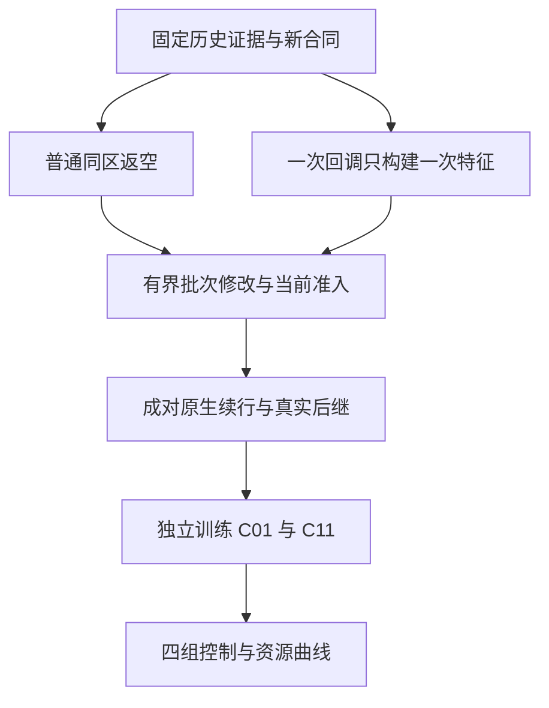

# G31 固定提交独立审阅与下一阶段 Codex 实施任务书

日期：2026-10-20。审阅对象：`13cf8eeb9e9692eaf9eaf8b2ebbaeee8e1001626`。研究分支：`codex/g31-ics-v3-circulation`。

本文是给 Codex 的连续推进指令，同时保存本轮审阅的证据、判断、文献边界和转向条件。所有建议的新参数都是本项目下一轮的工程试验设置，不是引用论文的参数，不是已经实现或已经通过的结果。

## 0. 先读结论与执行优先级

**可以进入机场学习实验，但目前没有证据证明机场 RL 控制有优势。最值得投入的下一步，是补齐普通同区返空、建立真实的动作选择机会，并采集同一物理前缀下不同动作的原生续行。** 不继续以增加 epoch、扩大网络、重复影子评分作为主要推进方式。

本轮发现的三个关键问题是：

1. 59400 秒仍有 20491 件已到行李等盘，22 个托盘中却有 13 个处于 `empty`，全部位于国内卸载端。当前规则和 native transfer 都排除同区调拨，卸载后也没有普通同区返空 leg。这是应先补齐的共同循环能力，不能把修复收益计为 RL 收益。
2. 81 条机场训练记录只有 63 个不同起点，同一时刻的多个请求共享完全相同的全局 300 秒目标。该目标由共同积压主导；仅时间的一元描述拟合已可解释绝大部分变化。当前数据支持行为续值拟合，尚不足以识别替换动作的收益。
3. 57900 秒影子回调中的 13 个 proposal 是原匹配方案的一批 13 个不同托盘调拨，不是 13 个互斥动作。学习入口必须明确为对原未提交批次的一次有界修改，不能取 top1 后丢掉其余原业务动作。

**减少托盘可以做，作为预登记的资源敏感性实验。** 保留原 22 盘历史锚点，先修共同循环，再比较 18、22、26 盘。不能反复减到 RL 赢了才报告，也不能把缺少普通返空动作造成的损失包装为预测优势。

实施依赖：



R1 区域自主控制与 R2 托盘预测预调的研究主线保留。首轮固定 R1，优先识别 R2 的边际贡献；联合 R1/R2 的收益需要后续联合消融，不能由本轮单独推断。

## 1. 审阅范围：做过什么，没有重跑什么

### 1.1 固定范围

- [固定代码与科学证据提交](https://github.com/czr5454112-glitch/jichang_origin/commit/13cf8eeb9e9692eaf9eaf8b2ebbaeee8e1001626)。
- [后续文档提交](https://github.com/czr5454112-glitch/jichang_origin/commit/41b27dbe70d629239ff150a721691d98421e98ae)。两者比较只有审核请求和三份发布核验收据，共 4 个新增文件；未将后续文档冒充新科学结果。
- 本地完整固定归档解压了 35203 个普通文件、3883714233 字节。归档下载 SHA256：`ec48667d572cf0dba908acf20345ede583f0abed5861b03e086cc94349993c84`。
- 读取了 native 循环、协议、候选、机场接入、特征、行为训练、预测及 FQI 相关源码，并读取实际保存的原始输入、原生结果、标签和回调证据。

### 1.2 本轮独立执行的核验

在完整固定提交上执行了：

```text
python outputs/experiments/g31_ics_sustained_flight_20261019/publication_001/verify_publication.py --root .
```

结果：15100 个清单文件、13260 次历史源码归档检查、1 个无损原始流检查通过，`failures=[]`。这验证已保存字节和来源关系，不证明算法有效或外部依赖可重建。

另做了标准库重算：机场终态和静态正容量路径；81 条全人口积分、时间/积压的描述回归；B1 父组切分和 Gamma–Poisson 先验参数；小域 FQI 支持动作与保存结果交叉核对。标签积分和标量回归是独立实现；88 维特征变化统计按固定源码的纯函数提取复核，不称为另一套独立特征实现。

**本轮没有重新训练预测器或策略，没有执行 Windows native，没有重新构建 C++，也没有重跑报告中的 1049 项 Python 顶层测试。** 所有实际训练、原生运行、运行耗时和测试总数均来自固定提交中保存的证据；本审阅只在注明之处作了重算。闭式一元描述回归不算策略训练。

随本任务书提供的复核包包含只读诊断脚本和本轮输出，供 Codex 在完整固定仓库上复算；不包含数 GB 原始仓库，也不改写历史工件。

## 2. 验收、限域接收与拒绝清单

| 项目 | 本轮判断 | 可使用的表述 |
|---|---|---|
| 发布来源与字节固定 | 接收；本轮实际执行核验通过 | 固定证据可按清单重算 |
| B1 航班条件预测训练 | 限域接收 | 历史父组代理、静态计划假设下的需求预测器已训练 |
| 小域自然重复决策/FQI | 限域接收 | 存在真实多步转移、受支持动作 bootstrap 和原生模型选择 |
| 小域 RL 增量 | 不成立 | 正式结果与强规则完全相同，增量为 0 |
| 机场 81 行行为价值模型 | 限域接收 | 一个物理父轨迹上的 train-only 行为续值预训练 |
| 两次机场影子消费 | 接收其机制证据 | 权重在实际回调中被调用；未改变动作 |
| 机场多步 RL / 控制收益 | 不接收 | 尚无相应证据，需要新实验 |
| `receiver reserve=1` | 限域接收 | 一个明确接收政策修订缓解了已发现的等待环 |
| 机场整体闭环质量 | 不接收为已充分解决 | 窗口推进成功；大量已到业务未完成，普通返空能力仍有缺口 |
| 100 ms | 不接收为已保证 | 小域样本不足；机场完整回调明显超时；R1/R2 应分开测量 |
| 创新性 | 可以形成有价值的具体贡献，尚待证明 | 不声称“预测＋RL＋分布式预调”这一泛化组合首次出现 |

### 2.1 按严重性排列的问题

下表源码路径均相对于固定提交。行号只用于定位该提交，不能在后续修改后继续引用为新版本行号。

| 编号/优先级 | 定位 | 最小反例或实际见证 | 影响与最小修复 |
|---|---|---|---|
| F1 / P0 | `cpp/ics_core/runtime/circulation_runtime_impl.hpp::circulation_progress` 402–488，尤其 453–454；生命周期 746–756；`analytic_control.py::transfer_candidates` 592–598 | node120 的实际 empty 到同区 loader57 有正容量路径，规则排除且原 transfer 拒绝；hold 完成只变 empty | 缺少普通同区返空。新增显式 scope，复用当前协议和资源准入；所有算法共享新 baseline |
| F2 / P0 | `foundation_airport_flight.py::make_rule_planner` 138–151 | 457 次晚段回调，397 次已有 intents，60 次无 intents 且无 supply | 预测入口结构性零机会。将学习放到新可选承诺之前，不能只等规则无事可做 |
| F3 / P0 | `analytic_control.py` 605–635；`foundation_airport_protocol_v2.py` 137–153；`foundation_airport_learning_public.py::proposal_actions` 207–223 | 57900 秒 13 个原 proposal 属于 13 只盘的匹配批次 | 不能直接当成 13 选 1。定义整个未提交批次上的 bounded patch，并每次提交后重读 current |
| F4 / P0（控制晋级） | `foundation_airport_campaign.py::compare_all_jobs` 337–362；`foundation_airport_flight.py` 125–127、154、204 | 机场原生合法 ACK 并没有调用小域逐件保护；28076 个 offered jobs 尚未完成 | native 合法性不等于逐件不退化。机场当前义务保护与离线终局比较分别实现和报告；未覆盖动作不进入安全接管 |
| F5 / P1（训练前） | `foundation_airport_behavior_readiness.py` 237–247；`foundation_airport_behavior_evidence.py::realized_return` 229–245 | 43320 秒 4 个实际请求共享同一目标 −4284240.05471 件·秒 | 行为联合续行目标缺少动作对照。采同前缀不同动作的实际续行，不能只中心化旧目标冒称因果标签 |
| F6 / P1（训练前） | `foundation_airport_behavior_evidence.py::execution_asof` 170–226；readiness 229–253 | 81 条中 59 条静态到达估计已超过 300 秒，仅 2 条在 300 秒内收到盘 | 300 秒对多数接收端效应过短；成功启动筛选不能迁移为一般 Q 数据准入。统一预登记窗口/真实后继，保存失败和截断 |
| F7 / P0（性能并行） | `foundation_airport_behavior_shadow.py::score_record` 87、94–99；`foundation_action_value.py::features` 254–261、`predict` 318–323 | 13 个动作先提特征一次，再随三个模型各做一次 | 同回调做 4 轮完整特征和验证。准备一次不可变 current 上下文，构造一次矩阵，再做纯前向 |
| F8 / P1 | `foundation_airport_learning_public.py::adapt_accounts` 74–163；`foundation_action_value.py` 302–310 | 81/81 source、destination deficit/scarcity 均因不完整账户被 mask | 缺失处理正确，信息仍不足。按实际收益需要补合法 owner-local 接收/承诺证据，不能私有全局账本补零 |
| F9 / P1 | `foundation_flight_training.py::evaluate` 169–188 | 无计划统计对照收到 evaluator 按 STD 父组子群筛过的到达流 | 这是统计子群比较，不是已实现的 native C00/C01 消息接口。四格必须使用真正当时收到的消息流 |
| F10 / P1 | `foundation_multistep_learning.py::train_fqi` 548–582，尤其 554；`foundation_fqi_checkpoint_selection.py` 190–225、304–359 | 旧入口仍要求原 MC-MSE 选择字符串；本轮已有一次看过 dev 后的修订 | 新一轮采集前接通并冻结与控制目标一致的选模规则。保存旧试验，不能反向修订其“预登记” |

这些问题不否定现有权重、原生消费和保存证据的真实性；它们限定这些工件目前能支持的结论。

## 3. 机场运行：先修普通循环，再讨论盘数

### 3.1 59400 秒的实际分母

证据路径：`outputs/experiments/g31_ics_sustained_flight_20261019/cycle_001/C00_receiver_recorded_budget_002/`，输入 `inputs/C00.json`，结果 `C00/raw.json.gz`。

| 指标 | 数值 |
|---|---:|
| 完整人口 | 28506 |
| 已到业务 | 20924 |
| 尚未到达 | 7582 |
| 已完成 | 430 |
| 已到业务完成比例 | 约 2.055% |
| `waiting_for_tray` | 20491 |
| 载货在途业务 | 3 |
| 托盘 empty / loaded / empty_transit / quarantined | 13 / 3 / 5 / 1 |
| 原生总体 strict_nonharm_certified | false |

`430/28506` 是完整输入人口口径；服务诊断还必须给 `430/20924`，避免把尚未到达的 7582 件当作已经等待的业务。不能只对完成件计算平均时间。

58200、58800、59400 秒完成数为 415、422、430，末段仍有物理移动，所以不能把整个系统称为完全死锁。当前数据足以说明严重的回供/拥堵问题，尚不足以把全部损失唯一归因于一个机制。

13 只 empty 均在国内节点 60、71、73、87、114、116、120；没有 active leg 或在途边。原始可用时刻和当前状态显示部分盘长时间停在卸载端，但最终状态本身不构成任意时刻立即可调的证明。

### 3.2 两个可复核的正容量同区例子

| 当前实例 | 实际等待目的地 | 静态路径 | 服务加运输估计 |
|---|---|---|---:|
| `initial:95:0` 位于 120，自 24680.559 可用 | loader57：2201 件等盘 | 120→121→123→125→127→130→57 | 169.652 秒 |
| `initial:149:0` 或 `initial:149:1` 位于 87 | loader95：4723 件等盘 | 87→89→132→95 | 147.202 秒 |

均为同一 domestic owner；路径上的边容量为正，节点容量为 4，输入故障列表为空。计算按 `PublicTravel.complete` 的公开静态算式独立实现。

**这只证明静态拓扑不是阻断原因。** 当前 FIFO、节点/边占用、接收资格、不可撤 lease、命令和 ACK 延迟仍需 native 处理；上述估计不能被称为已获许可的最早实际到达时间。

### 3.3 `local_empty_return` 的最小实现边界

保留既有跨区 transfer 的默认语义，在 `CirculationTransfer` 新增版本化的 `transfer_scope`：

- 缺省 `cross_zone_transfer`：旧 `same_zone_transfer_not_authorized` 原样生效。
- 显式启用 `local_empty_return`：要求 source≠destination、同 zone、同 resource owner、目标属于公开声明 loader 集；只针对当前真实、未承诺、可用 empty。
- 未知 scope 显式拒绝。目标角色来自版本化静态合同；不能根据私有未来 job 推断目标是否为 loader。
- 仍调用 `client.submit(owner, "transfer", payload)`，复用 source FIFO/min-stock、receiver admission/reserve、原接收 lease、ACK 和 `empty_return` 实体 leg。不新建全局事务，不走 legacy recovery，不制造虚拟业务。

必须贯通的已有文件：

| 文件 | 需要落实的变化 |
|---|---|
| `cpp/ics_core/runtime/circulation.hpp` 54–63 | transfer 数据结构、默认旧 scope |
| `cpp/ics_core/bindings/circulation.cpp` | 输入解析/输出中的 scope |
| `cpp/ics_core/bindings/circulation_session_binding.hpp` 381–389，以及 transfer render 字段 | 真实 binding 接收并传入 scope，结果/观察可审计 |
| `cpp/ics_core/runtime/circulation_protocol_impl.hpp` 36–45 | scope 纳入不可变请求身份、重试一致性与权限验证 |
| `cpp/ics_core/runtime/circulation_checkpoint.hpp` | 序列化/反序列化、版本或兼容规则；不能把 scope 静默丢失 |
| `cpp/ics_core/runtime/circulation_runtime_impl.hpp` 430–488 | 原跨区分支保留；新 scope 经同 owner/角色检查后复用实际资源准入 |
| `scripts/experiments/g31_ics_circulation/analytic_control.py` | 将普通同区回盘加入共同反应式控制，明确与跨区再平衡分开 |
| `foundation_airport_protocol_v2.py`、机场域构建模块 | 接入公共角色合同、作用域、完整回调与 residual 批次 |

**不得只在 Python payload 加字段。** 当前 binding 不读取这个新字段；只加字段不会改变 native。scope 若不进入 request identity，相同 request_id 改 scope 可能被误当原请求重试，这是必须有反例覆盖的风险。

最小原生门禁：正常同区返空并再次载货；同区旧 scope 仍拒绝；跨 owner 冒充 local 拒绝；未知 scope 拒绝；相同 request_id 改 scope 拒绝；在途/已承诺盘重复申请不能产生第二条实体 leg；满 receiver 与 reserve 仍有效；原跨区 ACK/重试/不可撤接收链通过。新增代码需要实际重建和相关 C++/binding/协议测试，不能用 Python mock 替代。

### 3.4 receiver reserve 与等待环的下一步

保留原 `reserve=0` 的 7 件结果和 `reserve=1` 的 430 件结果；两者是接收政策合同变化，不是学习消融。不要逐节点试 reserve 直到完成量变好。

建议新增 `foundation_airport_wait_graph.py`，只读实际事件/许可来建立等待关系：谁占有节点或边、谁持有 reception lease、谁等待下一资源、谁承诺给谁，以及每条边的证据和时刻。分别输出：有持有关系的环、没有形成环的拥堵链、普通动作缺失、权限拒绝、静态不可达、可用但未尝试、departure lease 到期隔离。

新窗口中保存的 7258 次 native rejection（其中 reserve 3740、receiving full 3502）不能与 2349 次实际提交的行为分类混为同一分母：前者可包含同请求多次资源尝试。按 request_id、tray_id、owner、接收节点和实体 leg 分层统计，避免用重试数量当独立失败样本。

先在保持图、容量、headway、服务时间、22 盘和既有恢复条件的情况下验证同区循环。若还有等待环，只对有真实见证的因果关系做最小修复，并作为新合同对所有策略同时生效。

## 4. 学习入口：从额外 idle 分支改为真实可选承诺

### 4.1 入口应如何触发

现有入口 `baseline['intents']` 非空就提前返回，使未来航班信息无机会影响实际新承诺。新的入口位于：**当前 owner 已完成必要 R1 动作识别，但本轮可选空盘承诺尚未提交时。**

优先复用现有 60 秒 owner 控制机会；在已有卸载完成、盘实际释放、接收资格变化、合法计划版本到达等事件上只标记需要重评的状态。首轮不要同时改变频率、候选数、恢复规则和模型。以后若做事件唤醒，四组共享相同唤醒合同，另列频率消融。

一个机会至少保存：

```text
opportunity_id, owner_id, current_view_version, observed_at,
public_state_digest, immutable_request_prefix_digest,
baseline_batch_digest, mandatory_intents, optional_intents,
actual_uncommitted_trays, received_peer_message_ids,
candidate_catalog_version, K, P, peer_policy_version,
forecast_model_id (when allowed), forecast_asof, model_available_at
```

预测不需要每次 R1 路由调用都重做。不可变的静态计划/模型可以预加载；当前时刻的区间投影和信息有效期必须正确。后台产出只能是建议；返回前台时重新检查 current、owner/generation、实体盘、承诺、接收资格与保护，失效就保留当前普通控制。

### 4.2 动作单位

建议新增 `foundation_airport_opportunities.py` 和 `foundation_airport_batch_patch.py`，同时修改 `foundation_airport_protocol_v2.py` 的实际提交循环。

- `a_ref`：当前原规则完整批次及其正常 residual 续行。
- `a_patch`：只修改一只尚未承诺的实际空盘的一项可选分配，例如目的地或允许的出发时点；其他必要分配保留。
- `hold_optional`：仅暂停该项可选预调，R1/其余批次照常；不是把整个批次丢弃。
- 一次只准入一个 patch，实际提交后重新读取 owner view 和计算 residual；不得把旧批次作为永远有效的已验证列表。
- 已提交 payload、pending 请求、已获得 reception 的托盘属于固定前缀，不参与撤销或重排承诺。

当前公共候选目录应仅由静态图/角色和当时合法供盘生成。**不能让 C00/C01 获得按航班计划筛过的 shortlist，随后称它们“无计划”。** 计划可以在 C10/C11 中影响对共同目录的评估；如果未来另研究预测驱动候选生成，需要单列其信息贡献。

首批 bounded-patch 试验建议 `K_max=3`（含 a_ref），每个配对只实际续行 2 个分支（a_ref 与一个合法不同 patch）。这是新增试验上限；若现有更严格 K/P 合同适用，取更严格值并冻结。记录 K/P 的确切含义：候选条数、条件续行数、native 调用数分别计数。

### 4.3 物理合法与服务保护

保留原 R1 的 `.05` 来源约束、current、owner/generation、ACK、原逐件保护和恢复。新机场 scope 不得借扩大动作权限删除这些约束。

机场需要单独声明并实现当前义务保护的适用范围：已到业务的分配、当前 FIFO、本地库存下限、已授权路径/时间窗及不可撤资源前缀。共享通道和接收位的影响必须被纳入当前可证明范围；单看源端还有一只空盘并不够。

两条工作线并行：

1. **隔离原生配对与训练数据**：在声明的模拟评估分支中记录实际好坏结果和未完成，能够继续学习与诊断，不必等待全机场 28506 件全部完成。
2. **模型接管准入**：只有通过适用的当前保护的 patch 才能进入已保护的策略模式。保护不覆盖的状态回到普通控制。隔离试验中的合法执行、正 ACK 或离线好结果不能自动升级为在线逐件保证。

不能把所有 future job 暴露给在线 guard，也不能用离线 baseline 未来完成时间作为在线输入。对任意未知未来全部逐件不退化的主张需要明确假设/证明；有限窗口内的 `unknown_incomplete` 不能填成无害。

## 5. 下一批数据：直接购买动作信息

### 5.1 为什么旧 81 行还不够

独立描述诊断如下。全部在同一 81 行训练材料上计算，不是测试集成绩。

| 诊断 | 结果 |
|---|---:|
| 不同起点 | 63 |
| 有多行的同一起点 | 13 个，共 31 行 |
| 同一起点目标完全相同 | 是 |
| `300 × 当时全局积压 / 实际300秒积压积分` | 99.225%–99.920%，均值 99.675% |
| 只用时间的线性描述 RMSE | 6760.47 件·秒 |
| 只用时间的描述 R² | 0.999634 |
| 三个网络保存的训练 RMSE | 约 11818 / 11881 / 12395 件·秒 |
| 88 维中发生变化的维度 | 15 |
| 完整 source/destination deficit 被 mask 的行数 | 81/81 |
| 300 秒内实际收到盘 | 2/81 |
| 静态到达估计超过 300 秒 | 59/81 |

这说明当前数据中的动作效应难以识别，不证明网络内部只学了时钟，也不证明其余 79 次动作没有任何效果。源端占用解除、共享链路竞争可能早于接收产生影响。

### 5.2 成对续行的定义

建议新增 `foundation_airport_paired_continuation.py` 和 `foundation_airport_pair_dataset.py`。

对一个满足当前准入的决策前缀，运行：

```text
同一完整前缀 + a_ref   + 固定版本的后续策略 → J_ref
同一完整前缀 + a_patch + 固定版本的后续策略 → J_patch
advantage = J_ref - J_patch   # 成本越小越好，因此正值表示 patch 更好
```

相同前缀要求包括 native 物理状态、controller 状态、outbox、未到消息、已送达 ACK、pending lease、随机状态和不可撤承诺。只比较回调 JSON 或 receipt 前缀不够。

当前机场计划声明进程退出后不能直接恢复 native。**优先完整重放共同 warm-up；只有现有 checkpoint/fork 经无损状态和协议等价验证后才复用。** 每次重放和每个分支都计入 native 预算，不把半条 snapshot 当作可恢复环境。未来外生业务输入在 evaluator 内提前冻结，并按业务身份固定随机数；不得因动作改变事件顺序就抽到另一条需求轨迹。

建议主目标为完整人口在共同窗口中的未完成积压积分：

\[
J_{[t_0,t_1]}=\sum_i[\min(C_i,t_1)-\max(a_i,t_0)]_+.
\]

窗口内未完成的 C_i 按右截断计费，计算该有限窗口成本时可用无穷大的完成时刻；**不能因此声称其真实完成时间已知或逐件不退化**。额外保存 deadline、已到未完成、等盘、载货占用、空行程、接收承诺和保护结果，不仅保存合成 reward。

`J_ref-J_patch` 消除同前缀的共同积压背景，但只有真正运行两条续行才是动作对照。把旧 81 行减去均值不产生反事实。

### 5.3 时间窗口与机场时钟

旧 300 秒标签原件保持。新配对首轮统一试验窗口建议 1800 秒，与已有最长 B1 预测窗口对齐；这是工程初值，不是到位保证。

- 记录每条分支从提交、ACK、首边、接收、下一次载货到实际下一决策的时间。
- 先在开发数据检查窗口是否覆盖接收端和后续使用；不允许只为获胜分支延长窗口。
- 若多数开发分支在 1800 秒仍未覆盖目标效应，可在测试前公开一次统一窗口修订，重跑所有受影响对照；或直接采用真实同 owner 后继的 SMDP 转移。
- 已知截断不得填零 terminal reward，不得伪造下一状态，不得把 successor 时间硬改成固定步长。

历史验证继续用原 0→59400 与 57600 附近的门禁。新的独立父轨迹可采用共同 warm-up 0→7200，控制评估 7200→59400；配对锚点只能在使完整标签闭合的时间段内产生，例如开发用 7200–14400、28800–36000、54000–57600 的既有 60 秒机会。锚点按当时公开的资格筛选和固定顺序选，不能先看哪个产生正收益再选。没有合格机会本身应报告。

**新早段实验必须修正“模型可用时间”和“日内时钟”的表示，而不是降低历史 gate。** 建议给每个物理父轨迹显式 `calendar_start`，所有计划发布时间、STD、arrival、模型训练标签闭合时间和模型使用时间在同一绝对时间轴核验。B1 和策略在较早已闭合父轨迹训练，才可用于后续父轨迹的早段。旧模型 43200/57600 门禁在历史域不变。不能把机场时间压缩成小域 40 秒，也不能通过改 episode_id 绕过源域/时间绑定。

### 5.4 父谱系与最小样本安排

旧一个物理父轨迹及 26 个非重叠窗口全部保留 `train-only` 身份。模型种子、窗口切分、同一轨迹的 replay 和成对分支都不是独立机场日。

优先使用已有合规生成器生成不同的完整外生父轨迹；若只有单日历史模拟代理，可做预登记的条件合成父轨迹，但必须标 `synthetic`，说明共同历史模板和采样机制。不能复制同一条流改名字。每个父轨迹内各算法使用同一图、完整业务集合、到达、STD/deadline、服务、托盘初始化和恢复条件；跨父轨迹的业务生成变化必须事先登记。

首轮可冻结父种子：train `701,702`，dev `801,802`，test `901,902`；策略种子继续 `17,29,43`。这些编号只是可复现工程选择，不代表独立真实日期或统计样本量。分组在分支生成之前完成，所有共同前缀后代属于同一个父组。

新 C01/C11 的 scaler、特征选择、训练超参只看 train；dev 做既定选模；test 不参与候选设计、选模和盘数选择。若需要使用先前已看过的同父轨迹，明确归为开发/机制核验。

### 5.5 失败与删失

- 未提交的 guard 拒绝候选：保存 mask/原因，不伪造反事实业务标签。
- 已提交后被 native 拒绝：保存真实尝试、回退和实际区间收益，不能从策略评估分母删除。
- 首边晚到、ACK 晚到、接收晚到：分别记录；不自动判成成功或无效。
- 行政时限、事件预算、进程失败、日志截断：保存实际闭合前缀与删失原因；不得只统计成功运行。
- 对照未到共同终点：保留失败率与可比较公共前缀，主完整窗口配对标记不可判。不能将提前停止后不再累积的成本当作更好。

## 6. C01/C11 训练与真正多步化

### 6.1 第一批模型应学什么

首先比较低成本参考：状态/时钟行为续值、简单动作交互模型、既有小 MLP。目标是成对成本差/动作排序与真实区间回报。保留旧 88 维模型作为历史行为预训练，不把它静默绑定新 local-return 合同或新动作 schema。

不强制先补完整六账户：可先用合法当前库存、已到等待、公开释放估计、缺失掩码、飞行计划预测和明确动作字段。确实出现同特征却需要不同动作的反例时，再补相关 owner-local 信息。

若补账户，优先给 receiver 提供自己实际获得的 inbound reception lease 与已收到的 peer ACK 摘要、as-of 与完整覆盖范围；不要用发送方私有未送达账本或完整 future truth 补齐。静态路径估计应保留 `public_static_capacity_relaxed_estimate` 的语义，不能改名为已认证最早到达。

### 6.2 多步训练的最小条件

- 相邻动作之间存在自然物理推进，同 owner 的实际下一个机会能被绑定。同一时刻的 residual 批次请求不能伪装成经过物理时间的多步转移。
- 同一次动作确实改变后续位置、可供盘、资源或业务结果；不是只修改观测字段。
- reward 区间来自实际时间跨度，peer policy / continuation version 固定并记录。
- Bellman 目标只在真实 successor 的受支持合法动作集合上 bootstrap；只有一个支持动作就使用该动作。不能按全局动作名称拼凑别的状态样本后取 max。
- 无已观测 successor 或行政截断时保留未知，不伪造 terminal；可用已闭合 MC 目标单独训练，但名称不能改成多步最优 Q。
- 在未见状态上的网络泛化属于需验证的假设，不能被“动作名字训练中出现过”替代。88维摘要仍是部分可观测表示，特征向量相同不证明完整物理状态相同。部署 mask 和支持域定义单独保存。

修改 `foundation_multistep_learning.py` 和 `foundation_fqi_checkpoint_selection.py`，将本轮公开的选择修订整理成新 schema 下的正式入口。旧小域的 9 行、6 非终止转移和 18 份权重不重写。

建议首轮沿用每个信息变体 3 个种子、最多 5 次 FQI 更新、每次最多 100 epoch 的有限上限；更早收敛可依预定 dev 规则停止。小数据不能靠训练轮数替代。训练需要保存全部最终权重和曲线，但正式选择优先看开发配对 regret/原生控制目标及失败约束，不能训练后才换成对自己有利的准则。

## 7. 公平四组：先固定共同物理域

| 组别 | 额外航班计划/B1 | 控制方式 | 必须保证 |
|---|---|---|---|
| C00 | 无额外未来计划 | 最强预算内反应式规则 | 已知实际业务的 deadline 等正常 R1 信息保留 |
| C10 | 同一冻结 B1 与合法静态计划 | 有预测的强规则 | 能实际预调；不是保留零机会的旧 C10 |
| C01 | 无额外未来计划 | 独立训练的学习模型 | 不读取计划，也不读取计划筛选的候选目录 |
| C11 | 与 C10 相同冻结 B1/计划 | 独立训练的学习模型 | 与 C01 同训练预算、动作合同、保护和恢复 |

所有组共享同图、同业务、同 N 和初始位置、同域 OD/receiver reserve、同 K/P、同 R1 和恢复、同静态动作目录/候选生成规则/机会触发规则、同公共消息接收规则。各分支按自身真实 current 生成合法集合；轨迹分歧后不强求机会时刻或有效候选完全相同，也不能借用另一分支的支持动作。C01/C11 各自训练标准化器；把 C11 的预测特征置零只能作为敏感性检查，不是 C01。

C00 的强规则至少使用当前等盘队列、当时合法供给、公开估计旅行时间/拥堵信息；C10 再用同一 B1 评估目的端需求和源端机会成本、已知在途/承诺。优先增强现有 analytic rule，不另起一个昂贵全局 MPC 项目。规则参数只在 dev 选择，并纳入相同计算预算。

主表按成本 J 报告：

```text
预测对规则的增益        = J(C00) - J(C10)
无计划条件的学习增益    = J(C00) - J(C01)
同预测信息的学习增益    = J(C10) - J(C11)
预测与学习的交互        = [J(C10)-J(C11)] - [J(C00)-J(C01)]
```

同时逐父轨迹、逐模型种子列出原始结果，报告实际不同选择次数、成功实体执行、到达前预调到位、首次服务、完整未完成分母与逐件差异。少数模型仅在一个运行上略优不能当稳健优势；两个留出合成父轨迹仅是方向性试验。

### 7.1 晋级标准

**G0：机制可训练。** 新 scope 的实体链闭合；至少两种真实可选动作；同前缀不同动作有可重算的不同成本/后继。12 个预登记配对若全部只有数值噪声、保护后只有一个动作或同一规则始终占优，先诊断机会、窗口和规则，暂停扩大网络。

**G1：机场学习主导控制成立。** 学习分数在当前准入后实际改变一项非重试提交，并有真实 ACK、唯一实体首边、接收/后继和业务结果。训练成功/数值交互/影子调用不满足该门槛。

**G2：学习有增量。** C11 对同信息 C10 的成本改善超过重算精度与明确的决策成本，且没有新增保护违例；完整失败与未完成均计入。可以报告小的可辨识改进，不需要为了满足事后百分比而挑场景。是否值得继续扩大计算投入，在测试前另冻结工程收益阈值；它不能被冒充统计显著性。

**G3：稳健/论文主结论。** 增加独立父轨迹和负载类型，按父轨迹做配对区间，说明合成到真实日的外推限制。不能把 81 行、26 窗口、3 个模型种子或 bootstrap 次数当独立机场日。当前首轮预算不承诺完成该级别。

## 8. 性能：取消统一 100 ms 卡点，保留实际新鲜度和前台预算

13-proposal 回调的完整时间为 8.9735710 秒；B1 为 0.1466544 秒；初次 features 为 1.8166229 秒；三个模型阶段约 1.825221、1.7883051、1.8184732 秒。后四项合计 7.2486222 秒。源码表明重复构建特征/验证当前大对象是明确可减少的成本，不能把全部时间归因于神经矩阵计算。

建议在 `foundation_action_value.py` 新增内部 prepared-context/feature-matrix 路径：

```text
当前公开观察 → 一次校验及不可变副本 → 一次账户/索引准备
           → 按固定候选顺序的一份特征矩阵 → 各冻结模型纯前向
```

同时调整 `foundation_airport_behavior_shadow.py`、`foundation_airport_behavior_consumer.py` 和 `foundation_airport_learning_public.py`。外部 JSON API 仍校验；内部对象不得用任意 `trusted=True` 绕过验证。每次新 callback 都重新建立 current 绑定。静态模型、receipt 和源合同可预验证，当前 model_available_at、owner、信息变体与时效检查仍保留。

保存原 2/13 proposal 回调完整输入，在新实现中对原动作序列做逐字段/字节特征比较、既定浮点容差前向比较及异常反例。然后实际 native 回调至少验证一次大候选实例，测含存储的全过程；不能只给缓存命中或矩阵乘法微基准。

三个随机种子用于科研重复，不要求在线每次执行三模型集成。正式策略按冻结 dev 规则选一个模型；如果研究 ensemble，单列计算预算并让基线公平使用预算。

100 ms 不再作为 B1/R2 每次调用的统一学习准入门槛。R1 必需路径的原目标、实测 p50/p95/p99/max、超期回退仍单独保留。R2 可以异步：普通控制持续前进，worker 返回时重新 current 准入；过期/超时/守卫拒绝均记录。**当前同步仿真在 callback 期间停止时钟，不能据此声称 8.97 秒结果已可真实实时执行。**

## 9. 托盘数量：可做，并且应检验资源节约

### 9.1 不先以减盘补救代码缺口

当前 13 个 empty 和普通同区返空缺失说明总量不是唯一问题。预调最可能在“存在安全可移动余量，但未来供需在时间和位置上错配”的区域产生价值。盘太少时可能没有任何可调余量；共享通道/接收位严重拥堵时提前搬运还可能增加阻塞。

本轮保留 22 盘原始记录；在共同新 baseline 成立后预登记 `N∈{18,22,26}`。18 是约 18.18% 的减少，26 用于区分供给不足和更多占用，两者不是文献指定最优值。

### 9.2 初始分布必须固定

原 22 盘是以下 11 个节点各 2 盘：`0,24,26,49,57,92,95,134,136,138,149`。

- 18 盘：每节点至少保留第一盘，从 4 个节点按事先固定、区域/角色分层的排序移除第二盘。
- 26 盘：按同一静态规则在 4 个合法节点增加第三盘；不能突破节点实际容量或凭空新增存储位。
- 排序只用静态角色、owner、节点 ID 和预登记布局种子，不能用 RL 结果、未来到达或已知最有利空盘滞留位置。
- 同一 N 的所有方法完全相同初始化。保存嵌套 tray ID/位置清单；后续至少增加另一布局种子以区分数量和位置效应，首轮一个布局只能报告条件结果。
- 每个 N 从自己的合法初态重新连续运行，不能在 22 盘 warm-up 后删除在途/已承诺的 4 盘。

保持旧 6673 件 OD 映射、新 receiver reserve 和其他合同一致。原域/新域、旧接收政策/新政策、算法之间的收益分别报告，不能互相替代。

### 9.3 两种不同的结论

同资源增益：

\[
\Delta J(N)=J_{\text{同信息强规则}}(N)-J_{\text{学习}}(N).
\]

资源节约：

\[
N^*_{\pi}=\min_{N\in\{18,22,26\}}\{N:\pi\text{达到共同预先规定的服务要求}\}.
\]

后者只是已测网格的最小值。`18盘RL > 18盘规则` 不等于“18盘可替代22盘”。缺少真实机场 SLA 时，可以预先定义相对目标：对修复后 22 盘同信息强规则的服务向量不劣，同时报告绝对完成、准时、未完成、deadline、逐件保护和计算成本；明确它只是研究相对目标，不是现场验收标准。

需求生成未变时 B1 冻结。仅用 22 盘训练模型测 18/26 盘应标为资源分布变化的泛化试验；要声称少盘条件下的可训练能力，应在相应资源域的 train 父组采配对数据，公平训练 C01/C11，或预先登记混合 N 训练并让所有信息变体共享数据预算。所有 N 变体继承原外生父谱系：train的后代只用于拟合，dev的后代只用于诊断/选模，不能因为改变N就跨切分。新模型只读取公开静态总资源合同/合法局部资源信息，不增加私有全局实时状态。

首轮资源附加曲线可只比较 C00、C10、C11；它是资源敏感性补充，不称作每个 N 都完成了四组全消融。若要声称“学习与预测交互在少盘更强”，则必须把 C01 也补到各 N。

若额外托盘可以被合法停放且完全不使用，更大资源集理论上可以模拟较小方案；实际控制器性能非单调不等于最优性能必然非单调。当前不能凭空新增离网停车来建立这个条件。

## 10. 有限预算下持续推进：不要做完一项就停

### 10.1 首轮执行合同

在研究分支建立新目录，例如 `outputs/experiments/g31_ics_action_value_20261020/cycle_001/`。不要修改旧 cycle。先记录任务清单、源码归档、域/模型/父谱系/预算，再开始运行。

首轮建议上限：**16 小时为全任务停止上限；72 条长 native 分支、14 条短 native 语义门禁、12 次学习训练分别限制该类新增作业。** 达到训练上限后仍执行剩余预算内的冻结评估，不能因训练完第12个模型就停止。所有共同 warm-up 重放、baseline、失败重试、配对分支和模型评估都占相应预算。它们不是成功样本数承诺；不要求为了用完预算运行已经确定无信息的实验。

一次学习训练作业指一个信息变体×一个模型种子×一个训练资源域的完整有限训练链，包含预登记的 MC 初始化和最多5次 FQI 更新；实际 fit 次数、epoch、wall time和失败重试另行累计，不以改作业名称绕过上限。常规非native单元测试和编译也计入16小时总时间。

**执行顺序固定为 A→B/C及E/F→两类模型全部训练/选模冻结→D/G统一开放test。** 批次字母只是预算身份。是否启动资源版训练只能依预登记的 train/dev 条件决定；不能看完 D 的测试成绩再设计 E/F 或训练 G 的模型。D/G 可共用 901/902，是因为两类策略都在这两个父组开放结果之前冻结。

长分支初值可沿用已测量的 `600秒soft / 660秒inner-hard / 720秒outer-hard`。新同区循环可能产生更多真实工作，先用首支实测校准；如需调整，必须在后续对照开始前统一登记，不能只给某个算法加时。整体 16 小时上限不随单次重试自动扩大。短语义门禁建议每支最多 90 秒。

| 批次 | 长 native 预留 | 产出与前置条件 |
|---|---:|---|
| A：共同循环与性能机制 | 4 | 新 baseline 连续运行、真实 large-K 回调、源/实体/保护核验；短 native 门禁另计 |
| B：首批动作配对 | 12 | 6 个预登记前缀 × 2 分支；先买有信息的动作差异 |
| C：后继与开发补样 | 12 | 再 6 个前缀 × 2 分支，覆盖 train/dev 父组及自然后继；已有支可兼采多条真实转移 |
| E：资源开发规则诊断 | 4 | 18/26 盘 × C00/C10；不按学习测试结果挑 N |
| F：资源配对补样 | 8 | 18/26盘各1个train前缀＋1个dev前缀，每前缀2支；同N的train和dev继承701/702与801/802各自父谱系，不混用 |
| D：22 盘四格 | 16 | 2 个留出父组 ×（C00、C10、3个C01、3个C11）；22盘版与资源版全部先冻结 |
| G：资源曲线 | 14 | 3个N×2留出父组×3策略本为18支；只有满足完全相同合同才复用D中的4支22盘C00/C10。C11用预登记seed29的资源模型 |
| 保留故障诊断余量 | 2 | 一次有明确原因的修复重试；失败仍保留 |
| 合计 | 72 | 若阶段前置条件不成立，转向诊断和可完成的其它任务，不伪造后续 completed |

首轮前缀分配可直接冻结：B的6对为701/702各3对；C的6对为701/702各补1对、801/802各2对。E只在dev801上比较两个N的规则；F在18盘取train701与dev801各1对，在26盘取train702与dev802各1对。某个预登记格子无资格就报告空格及原因，不从test补样，不把dev行改作train。该数量只够机制/方向性试验，尤其资源版每个N的数据很少，不能称充分训练或跨日稳健性已验证。

前 6 次训练用于 C01/C11 × 3 种子；资源开发补样若有价值，剩余 6 次用于预登记混合 N 版本的 C01/C11 × 3 种子。两类模型不得混名；资源版在 22 盘也需重新测，故上表 G 仅复用相同的规则支。单次训练先设置有限迭代/epoch，不能后台无限搜索超参。

两个真实 GPU 可并行训练信息变体/种子，但本轮主要成本是 native 和大状态处理，不需要扩大网络去占满 GPU。native 并发仅在 CPU/内存/I/O 实测允许且随机/目录互相隔离时开启；基准耗时校准单独运行，避免将并发争用写成算法延迟。

### 10.2 不停在阶段汇报的规则

- 完成一个任务后，自动领取依赖已满足的下一项；文档、CPU 只读分析和 GPU 训练可以在不共享可变状态时并行。
- 一项运行失败，保存原因和实际停止点；只修与失败直接相关的最小问题，然后继续可执行支路。不因一个环境/资源错误放弃全部任务。
- A 通过后必须进入 B；不能再以更多 publication hash、更多 shadow callback 或更多纯特征测试代替成对控制。
- B/C 没有动作可辨识性时，停止增大模型，转向 action/窗口/强规则诊断；E 的少盘规则诊断仍可执行。不能制造一个有利 future job 来制造正例。
- D 若与 C10 相同，诚实报告 RL 增量 0，执行此前已经冻结的 G，并作结果诊断；不得据此追加 E/F 训练、修改资源模型或把同一 test 重新当未见测试。进一步方法迭代使用新的父组与新周期。
- 如果所有合法动作集合基本是 singleton，输出各原因的完整分母与最小见证，给出下一项真正增加决策信息/选择空间的接口，不继续堆 epoch。
- 时间/原生/训练预算耗尽时保存可恢复任务状态、未完成条件和明确下一入口。不要把 process completed 自动升级成科学验收。

### 10.3 P0/P1 具体任务完成定义

| 任务 | 文件边界 | 必须交付的实际证据 | 完成判据 |
|---|---|---|---|
| P0-0 固定新合同 | 新 `ACTION_VALUE_CAMPAIGN_CONTRACT_20261020.md`、manifest/ledger | 固定源、旧证据指针、新域版本、种子/预算/信息流 | 未看结果前冻结；旧 source pins 不改绑 |
| P0-1 普通同区回盘 | §3.3 列出的 C++/binding/protocol/analytic 文件；建议新增 `test_g31_circulation_local_empty_return.py` | 实际原生语义反例、同区返回后再次载货、整段业务/托盘分母 | scope 真进入 native/identity/checkpoint，旧跨区限制通过；不凭空增加盘/容量 |
| P0-2 回调重复成本 | `foundation_action_value.py`、behavior shadow/consumer/public；新增 prepared-context 测试 | 原2/13动作字段等价、异常反例、真实全过程耗时 | 同 current 只建一次特征；跨事件 current 无缓存绕过；性能如实记录 |
| P0-3 机会与批次 patch | 新 opportunities/batch_patch 模块；`foundation_airport_protocol_v2.py`、flight planner | 候选/保留动作/固定前缀日志，真实 submit→ACK→唯一leg，失效回退 | 不再只依赖 idle 分支，批次不被 top1 截断；当前准入完整 |
| P0-4 等待与保护范围 | 新 wait_graph 和机场保护适配器；保留小域 guard | 实际等待环/链证据、保护能/不能覆盖的清单、unknown 计数 | 本地循环缺口与其它瓶颈区分，不能把物理合法称逐件保证 |
| P1-1 配对与真实后继 | 新 paired_continuation/pair_dataset；机场 campaign | 完整前缀、外生父谱系、两条原生续行、成本分解、censor、后继 | 至少存在真实动作差异与可绑定后继；无未执行候选伪标签 |
| P1-2 两信息变体训练 | action value、multistep、checkpoint selection | C01/C11各3种子、权重/曲线、冻结dev选模、支持动作审计 | 实际训练；无测试选模、无 unsupported max；新域新模型身份 |
| P1-3 四格真控制 | 新 four_cell campaign/evaluator | 同域同预算完整主表、逐件表、动作不同链、失败分母 | G1/G2分别判定；shadow不计控制完成 |
| P1-4 资源曲线 | 新 fleet_sensitivity 模块/manifest | 18/22/26嵌套初始化、各组原始结果、训练资源域与服务向量 | 全预登记点报告；资源节约和同N收益分开；不能调盘数挑胜者 |
| P1-5 交付 | 阶段报告、科学验收表、实际运行收据 | 运行预算实际消耗、negative结果、源/数据/模型绑定 | 在既有授权范围提交并推送研究分支，不合并main；最后明确下一未满足条件 |

新增模块名称是建议接口名，允许 Codex 复用等价既有文件以减少重复架构，但必须在交付中给出最终文件/函数映射。验收依据是实际行为和证据，不是文件名或测试数量。

## 11. 文献对照与创新边界

以下只保留与本轮决策直接相关的原始研究。2015 年论文虽旧，但直接覆盖联合载空管理，不能因年份旧而略去先行工作；2024–2025 年工作用于核对学习覆盖、近期机场 RL 和预测预调先例。

| 文献 | 与本研究的实际重合 | 本轮可借鉴与不能外推的边界 |
|---|---|---|
| Sørensen, Rosenberg, Karstoft, 2021，*Baggage Routing with Scheduled Departures using Deep Reinforcement Learning* | 航班时刻背景、ICS tote、集中 DRL 路由/入口队列平衡 | PDF第6页/出版p.18的blocking实验盘数并非所有方法相同；nonblocking统一40。支持核对物理入口与资源公平，不能推出盘越少RL越强 |
| Zeinaly, De Schutter, Hellendoorn, 2015，*An Integrated Model Predictive Scheme for Baggage-Handling Systems: Routing, Line Balancing, and Empty-Cart Management* | 预测需求、载货路由、卸载释放空盘分配/回程、库存容量 | 作者稿PDF5–9、14–15页；强基线已用队列/旅行时间。连续流和软时间窗不等于逐件保证，也没有验证RL |
| Cheng, Sharif Azadeh, 2025，*Real-Time Integrated Dispatching and Idle Fleet Steering with Deep Reinforcement Learning for A Meal Delivery Platform* | 需求预测＋RL派单＋局部闲置资源预调，明确去中心化 steering | §4.3/4.4/6.3；存在预调占用可用资源的代价。不是ICS不可撤接收协议；因此不能泛称“分布式＋预测＋RL预调”首次 |
| Hong, Tewari, 2024，*A Primal-Dual Algorithm for Offline Constrained Reinforcement Learning with Linear MDPs* | 离线数据支持、约束RL | 作者稿PDF4、10–11页；需要覆盖/结构假设，其期望累计约束不能给本项目非线性局部控制提供逐件安全证明 |
| Wang et al., 2025，*A Deep Reinforcement Learning Framework for Multi-Fleet Scheduling and Optimization of Hybrid Ground Support Equipment Vehicles in Airport Operations* | 机场地面车辆、航班任务时间线、集中PPO，并做车辆减少试验 | §3.1/3.2/5.6：不是ICS空盘模型；车辆减半后训练并不证明比同资源强规则好或达到最小fleet |

2025 Wang 正文区分需要保留：列出的观测包括距下一已分配任务时间、任务耗能和车辆/充能状态；没有建立机场 ICS 的空盘释放、行李到达预测或本项目 as-of 协议。文中可分布式部署的概括性表述不能当作独立多 owner 实验。这里只把它作为近期相邻机场工作。

### 11.1 下一阶段应争取的具体贡献

可以形成的研究问题是：**在有限托盘闭环、载空共享资源、区域局部信息、异步消息和不可撤接收承诺下，利用合法航班信息学习一个空盘承诺对未来系统成本的边际影响，并在当前保护下真实执行。**

贡献需要由以下对应证据支持：

- 区域自主：actor只使用自身/已送达公开信息，消息迟到/丢失/失效下仍遵守原义务；不能只把集中状态换名字。
- 预测作用：C10/C11相对无计划组存在真实到达前动作差异；不能只证明数值输入进网络。
- 学习作用：C11相对同预测强规则C10有增量，动作对照和真实后继解释其来源。
- 承诺与保护：模型建议不能撤销原有资源前缀，失败有原恢复；保护范围、unknown与实时成本明确。
- 资源价值：公平资源曲线显示相同服务下可减少资源，或者在相同资源下稳定改善服务；不删掉不利负载/盘数。

这是有意义的研究方向，但现有证据还没有完成全部贡献。不能保证“世界上没有完全一样的文章”；本轮针对性原始文献核查也不构成穷尽检索。应以清晰的方法和实验差异争取创新，而不是用术语组合保证创新。

### 11.2 原文链接

1. Sørensen et al. 2021，ISCSIC，pp.13–19，DOI [10.1109/ISCSIC54682.2021.00014](https://doi.org/10.1109/ISCSIC54682.2021.00014)。[Aarhus 官方记录](https://pure.au.dk/portal/en/publications/baggage-routing-with-scheduled-departures-using-deep-reinforcemen/)。盘数细节依据此前已核读的用户提供全文，本轮再次核对官方题录；不称本轮重新取得该全文。
2. Zeinaly et al. 2015，IEEE TCST 23(4):1536–1545，DOI [10.1109/TCST.2014.2363135](https://doi.org/10.1109/TCST.2014.2363135)。[官方作者稿](https://www.bartdeschutter.org/publications/15-019-integrated-model-predictive-scheme/15-019-integrated-model-predictive-scheme.pdf)。
3. Cheng & Sharif Azadeh 2025，arXiv:2501.05808v1，2025-01-10，按预印本引用。[全文](https://arxiv.org/html/2501.05808v1)，[版本记录](https://arxiv.org/abs/2501.05808)。
4. Hong & Tewari 2024，ICML/PMLR 235:18711–18737。[正式会议页](https://proceedings.mlr.press/v235/hong24e.html)，[作者稿v2](https://arxiv.org/pdf/2402.04493v2)。
5. Wang et al. 2025，Applied Sciences 15(17):9777，2025-09-05，DOI [10.3390/app15179777](https://doi.org/10.3390/app15179777)。[出版社](https://www.mdpi.com/2076-3417/15/17/9777)，[MDPI提供的23页完整出版正文](https://www.researchgate.net/publication/395447217_A_Deep_Reinforcement_Learning_Framework_for_Multi-Fleet_Scheduling_and_Optimization_of_Hybrid_Ground_Support_Equipment_Vehicles_in_Airport_Operations)。本轮出版社主站429，已核读其提供的完整正文。

## 12. 固定代码与证据索引

以下链接全部指向审阅固定提交，而非可移动 branch HEAD。

- [阶段报告](https://github.com/czr5454112-glitch/jichang_origin/blob/13cf8eeb9e9692eaf9eaf8b2ebbaeee8e1001626/docs/g31_ics_circulation/SUSTAINED_FLIGHT_LEARNING_STAGE_20261019.md)。
- [完整本轮证据目录](https://github.com/czr5454112-glitch/jichang_origin/tree/13cf8eeb9e9692eaf9eaf8b2ebbaeee8e1001626/outputs/experiments/g31_ics_sustained_flight_20261019)。
- [native循环实现](https://github.com/czr5454112-glitch/jichang_origin/blob/13cf8eeb9e9692eaf9eaf8b2ebbaeee8e1001626/cpp/ics_core/runtime/circulation_runtime_impl.hpp)。
- [协议transfer实现](https://github.com/czr5454112-glitch/jichang_origin/blob/13cf8eeb9e9692eaf9eaf8b2ebbaeee8e1001626/cpp/ics_core/runtime/circulation_protocol_impl.hpp)。
- [原反应式候选/批次](https://github.com/czr5454112-glitch/jichang_origin/blob/13cf8eeb9e9692eaf9eaf8b2ebbaeee8e1001626/scripts/experiments/g31_ics_circulation/analytic_control.py)。
- [机场真实提交循环](https://github.com/czr5454112-glitch/jichang_origin/blob/13cf8eeb9e9692eaf9eaf8b2ebbaeee8e1001626/scripts/experiments/g31_ics_circulation/foundation_airport_protocol_v2.py)。
- [航班规则入口](https://github.com/czr5454112-glitch/jichang_origin/blob/13cf8eeb9e9692eaf9eaf8b2ebbaeee8e1001626/scripts/experiments/g31_ics_circulation/foundation_airport_flight.py)。
- [机场行为目标](https://github.com/czr5454112-glitch/jichang_origin/blob/13cf8eeb9e9692eaf9eaf8b2ebbaeee8e1001626/scripts/experiments/g31_ics_circulation/foundation_airport_behavior_evidence.py)。
- [动作特征与价值模型](https://github.com/czr5454112-glitch/jichang_origin/blob/13cf8eeb9e9692eaf9eaf8b2ebbaeee8e1001626/scripts/experiments/g31_ics_circulation/foundation_action_value.py)。
- [原生影子评分](https://github.com/czr5454112-glitch/jichang_origin/blob/13cf8eeb9e9692eaf9eaf8b2ebbaeee8e1001626/scripts/experiments/g31_ics_circulation/foundation_airport_behavior_shadow.py)。
- [小域多步学习](https://github.com/czr5454112-glitch/jichang_origin/blob/13cf8eeb9e9692eaf9eaf8b2ebbaeee8e1001626/scripts/experiments/g31_ics_circulation/foundation_multistep_learning.py)。
- [选模修订](https://github.com/czr5454112-glitch/jichang_origin/blob/13cf8eeb9e9692eaf9eaf8b2ebbaeee8e1001626/scripts/experiments/g31_ics_circulation/foundation_fqi_checkpoint_selection.py)。

固定事实继续保留：B1开发/测试改善的区间跨零、90%覆盖仅71.43%；小域FQI与强规则相同；81行同父轨迹；两次shadow回调事后选点；100ms未保证；机场多步学习控制未完成；旧OD、reserve、失败日志与版本边界不改写。

**下一阶段交付应回答的主问题：修复共同循环之后，是否存在航班信息能够提前改变的合法真实空盘决策，以及学习是否比同信息强规则更会选择这些决策。** 用执行链、同前缀动作差异、完整业务成本和公平资源曲线回答。
