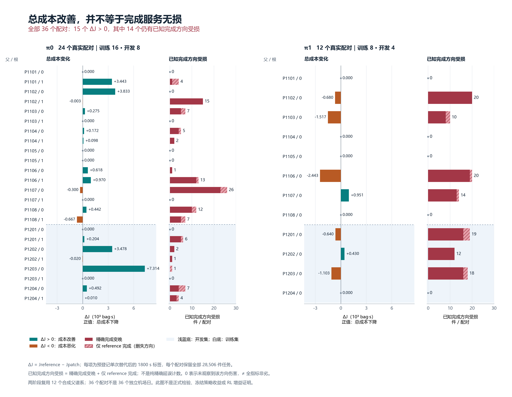

# 机场空托盘提前调度：机制证据、学习阴性结果与部分发布范围

科学范围冻结：2026-10-20T22:42:14.589551+00:00。原生与离线协调器均已实际终止，最终原生ledger及离线56-job行政生命周期已封账；DRAFT_001–008原字节保留。

实验运行身份为`1d895da00644c9486568fe74b835e057aa93f8c8`加本轮冻结的未提交源文件；runtime005源清单SHA为`9f3a6f6b15807d1fc6406d46b223677d070bf64e2ae3ca000120cb7ed51807d6`，native030的SHA为`aa2f115d68f4f2c2a3d1df64192ebb33f8468ed6ce1248d14ebbc5955e4ddd82`。后续发布提交不能改写为实验运行时身份。

本报告保留既有科学数据、失败及unknown。新增原生行政终态不等于正式算法验证完成；包、Windows Python3.11隔离审核和Git实际凭证另行记录。先冻结科学报告，再入CAS；报告不包含自身后续包SHA或发布GitSHA，避免循环依赖。

## 当前可确认的提升点与学习结论

机场成本的主要位置是等待空盘。旧场景中，实际需求优先后的R0库存回流使两父等待积分下降约376.6万和305.8万bag·s，完整J下降0.768%和0.624%，完成数增加277和246；但已知方向受损分别507和504件，P902准时数还减少2。R0不使用学习或航班预测，这些是规则策略的服务权衡，不能作为RL收益。

共同失败空盘恢复在旧N26 P902使最终隔离盘1→0、完成数增加21，J下降0.01381%；同时准时减少1、已知harm437，失败空盘leg1→7。它属于共同协议修复，不能归于RL，也未达到0.1%工程继续门槛。原字节回调、优先提交、实际导出和002→004六文件一致性均已有相应范围的闭合证据。

**首轮24根/48臂、第二轮12根/24臂均已闭合；6次首轮拟合已冻结，C01、C11与C10都选择reference。第二轮没有再次拟合，没有非平凡策略改进；目前仍没有冻结RL策略胜出的证据。本报告不读取或报告新正式held-out结果。** 6次最小范数/正则拟合的scaler、秩和数值解已复核；但开发全候选的未实测winner使6个学习模型的完整开发J全部unknown。这项数值检查不解决数据支持不足、识别性或策略收益问题。一个事后描述的train单动作案例提供了“空盘改派→较早装载及复用”的具体可能机制；它不是模型选中的动作，且仍存在等待恶化，不能替代策略验证。

π1全12对的预登记单次替代标签中，train正/负/零为1/3/4，dev为1/2/1，父均gain分别为−461.095875与−328.231058 bag·s；没有正收益点同时满足观察到的服务约束。`nontrivial_policy_improvement=false`保持不变。root已在完整π1门禁及collection之后生成正式解锁与固定40格名册。正式原生最终状态：40槽中36个已启动且owned complete，4个未启动，0个formal failed/unknown；所有40槽的primary_J保持null。离线56-job终账为44成功、3失败、9未启动，详见资源终账段。本报告核对名册、原生终账与离线行政生命周期元数据，全部正式业务结果留空；继续保留失败、零效应、reference胜出和unknown，不宣布最终完成、推送、减盘或稳健RL净收益。

## T01–T09 对照

| 任务 | 要求 | 证据层次 | 已知范围与缺口 |
|---|---|---|---|
| T01 | 旧34支与全人口七方向评估 | `saved_evidence_recompute_available` | 已闭合旧诊断保留全人口成本与七方向；正式单格描述性重算以外部审核范围为准，不形成整体排名。 |
| T02 | 共同失唤醒修复 | `native_microgates_accepted` | 旧N26两父诊断均已闭合；微反例和这两父不等同机场级无停滞。 |
| T03 | 失败空盘窄恢复 | `native_microgates_accepted_N26_P901_zero_activation` | N26 P901恢复开/关业务结果一致且恢复0次；P902恢复实际触发7次、J下降0.0138106%，已知harm437；不满足0.1%继续门槛或逐件保护。 |
| T04 | R0实际需求优先及库存回流 | `P901_raw_chain_priority_and_same_bag_verified` | P901完整原字节链、8次回流、priority与5个直达同包等待均已验证，3个非直达明确排除；P902小原始结果成本已重算，旧P902完整机制未在本报告重放；正式8个R0机制审计输出已闭合，限各自记录范围。 |
| T05 | 差分最小范数/支持回退/reference champion | `six_fits_frozen_reference_champions` | 6模型数值复核通过；完整开发J均unknown、支持不足，C01/C11均reference；真实正式策略仍待验证。 |
| T06 | 共同静态候选与预测排序诊断 | `three_resource_terminated_censuses_no_output; full_eight_parent_aggregate_unavailable` | P1301唯一重试及P1302/P1303首次尝试均exit1223、owned闭合、output=null；旧P1301 child退出仍unknown。固定8父完整统计不可由这些尝试齐备；P1304–P1308 census均未启动，不用成功子集或partial输出补足。 |
| T07 | 父计划、时钟与冻结 | `both_collections_bound_formal_unlock_registered` | 首轮train-only scaler与两轮闭合集合已绑定；正式解锁/40名册元数据已核，本报告未读正式plan/input/outcome。 |
| T08 | 24根π0与12根冻结π1成对续行 | `both_rounds_72_arms_36_pairs_closed` | 两轮raw/physical均通过；T08仍限selected-anchor小证据一致性，π1一次receiving_full拒绝完整保留；不证明全部ACK消费或严格非害，未第二轮fit。 |
| T09 | 新8父×5方法正式比较 | `partial:36_owned_complete_4_unstarted` | 固定40槽全部保留且primary_J全null；原预算停止。离线已有36 cache与8机制输出，另3 census失败、9项未启动，描述性成本不进入正式效应、均值或排名。 |

## 方法、人口与冻结域

| 方法 | 当前业务/空盘规则 | 航班B1 | 学习 | 解释边界 |
|---|---|---|---|---|
| R0 | 7200起actual-only，真实需求/mandatory先提交，fresh空优先批后最多一次库存回流 | 无 | 无 | 低信息附加对照；差异不能单归因学习 |
| C00 | 原规则含已声明内部释放估计 | 无 | 无 | 共同π0基准 |
| C10 | 与C11相同合法信息；开发reference/权重0/1显式竞争 | 同冻结参数 | 无 | reference胜出必须如实标记有效信息策略退化 |
| C01 | 同候选/保护；独立训练 | 无 | 最小范数差分 | 无支持/无净开发优势回退reference |
| C11 | 同候选/保护/预算 | 同冻结参数 | 独立差分训练 | 不能屏蔽C11特征冒充C01 |

新正式域固定22盘、同图/容量/服务、K≤13、60秒tick、7200共同热身、59400截止。
全人口每支28,506件；同父方法的业务/初盘/时延相同。11静态loader覆盖不意味着每回调有13个动作。
父1101–1108 train，1201–1204 dev，1301–1308 test；全组平移是同历史模板合成谱系，
不是8个独立真实机场日。第二批是同12父在后续日历重放，不增加独立父数。
首权重available为2026-09-28T23:59:59+08:00；dev选择时间另取最后自然标签闭合时刻；
round1最早2026-10-11，正式test冻结后一次解锁。两collection、冻结receipt与模型digest均保留原始绑定。

## 原生机制与旧场景诊断（不作新泛化）

| 验证 | 已有证据与缺口 | 不可扩大的结论 |
|---|---|---|
| 四节点队头过期 | 修前Y未完成；修后5.00000001重新仲裁、10.002唤醒、12.005完成；X仍隔离 | 不等于机场全域无死锁 |
| 窄恢复 | 原generation/failed transfer+leg绑定、ACK幂等、非法状态拒绝、失败史保留 | 不等于所有隔离原因可恢复 |
| R0短回流 | 无未来job卸载→普通回流；库存延迟/过期unknown；1↔0抑制 | 不等于机场服务改善 |
| R0 P901完整链 | 原字节1990条全链通过；8请求→8实体/收盘；5直达下一装载，其中3严格提前；优先次序通过 | 全部8条保留；另3条中途空返/不同目标不归因；5条等待变短中2条完成反而变晚 |
| R0 P902完整链 | 两支runtime005已闭合，小体积raw成本/全人口七类已重算；本报告未重放其完整机制 | 成本通过不等于回调/优先/实体链已重放 |
| N26 P901/P902恢复开关 | P901两支已闭合，J/1138件完成/94准时完全一致，失败/隔离/恢复均0；P902失败1→7、恢复0→7、末态隔离1→0 | 恢复从首控制tick生效，属于同初态协议对照；不要求7200 controller配置同，不是单动作因果pair |

诊断表逐支填：版本、closed/failed、J、等待J、loaded/processing J、完成、准时、
到期未完成、最长无EDGE进展、隔离盘秒、恢复成功/拒绝、空返距离、重试/拒绝、wall。
只以同父同合同完成比较；002/004完整等价核对单列，源SHA不同仍披露。

### 已闭合旧场景服务诊断

| 对照 | J_reference−J_candidate（bag·s） | 相对J下降 | 完成增量 | 准时增量 | 到期未完成增量 | 已知harm / improvement |
|---|---:|---:|---:|---:|---:|---:|
| N22 P901 C00→R0，runtime004 | 3,756,419.269 | 0.767893% | +277 | +1 | −277 | 507 / 1167 |
| N22 P902 C00→R0，runtime005 | 3,047,404.064 | 0.623684% | +246 | −2 | −246 | 504 / 1165 |
| N26 P901 REC0→REC1，runtime005 | 0 | 0% | 0 | 0 | 0 | 0 / 0 |
| N26 P902 REC0→REC1，runtime005 | 67,387.252 | 0.0138106% | +21 | −1 | −21 | 437 / 637 |

七类的固定顺序为精确变晚、精确改善、精确相等、仅reference完成、仅candidate完成、两支已到达未完、两支尚未到达。
P901 R0为`73 / 456 / 6 / 434 / 711 / 19241 / 7585`，P902 R0为`69 / 484 / 3 / 435 / 681 / 19247 / 7587`；
N26 P901为`0 / 0 / 1138 / 0 / 0 / 19783 / 7585`，N26 P902为`421 / 600 / 23 / 16 / 37 / 19822 / 7587`；各行均合计28,506，不丢掉未完成任务。
R0 P901最大精确延误2235.680秒、最大删失延误下界37802.457秒；
P902对应1800.021秒与37124.792秒。改善与服务伤害同时保留。
N26 P901 J=486,579,226.37064，J0=507,335,552.51364，relief=20,756,326.143，两支恢复未触发。
两组R0的同父输入、native与7200公共前缀已绑定；恢复对照从首控制tick开始，7200配置不同是处理本身。
这些是旧条件合成父的完整规则策略/协议诊断，不是新测试泛化或RL结果。

N26 P902 REC0→REC1：J从487,939,838.448495降至487,872,451.196495；完成1060→1081、准时94→93、到期未完成17478→17457。等待积分减少104,988.993 bag·s，但loaded/processing积分增加37,601.741 bag·s，净收益67,387.252。
原生失败空盘leg从1增至7，恢复0→7，最终隔离1→0；7次恢复只涉及2个实体（initial:136:1六次，initial:49:2一次），不是7个不同盘。按失败→实际恢复receipt/仍隔离截止计算的隔离盘秒为47685.391000→236.379000。失败史保留，恢复拒绝均0。
最大精确延误9775.611秒、最大删失延误下界6668.144秒；437件已知方向受损。两支最长无EDGE进展均7947.867秒，两个native invariant计数均0。恢复开关的成本改善低于0.1%，也不能据此宣称解决全部停滞。
恢复对照的7200 native SHA相同、controller history SHA不同；本次未读完整history，只确认plan.controller唯一声明差异为recover_failed_empty，不声称history字节差异仅有config。上述全部归于共同协议对照，不归于RL。

八诊断的独立等待/装载分解已逐字段匹配worker成本（`diagnostic_wait_load_decomposition_001.json`，0native）。等盘积分占J的99.8123%–99.8467%。R0 P901等待积分减少3,766,240.967 bag·s，而loaded/processing增加9,821.698，净减3,756,419.269；P902分别为减少3,058,248.778、增加10,844.714。恢复P902的等待减少104,988.993、loaded/processing增加37,601.741。该算术分解说明主要成本位置；不能把全部等盘积压当作RL可消除部分，也不证明单动作因果。

### 原字节回调兼容与实际工程等价证据

R0回调原件不改写：1990条、4,058,120,696原始record bytes全部校验，完整gzip尾、序号、previous hash与最终tail均通过。
旧decoder失败的8条仅涉及baseline/chosen中16个`inventory.nodes`映射：生产端整数键数值排序，经JSON解码成字符串后重新排序改变了字节。
新离线reader核对原UTF-8 record，不“修复”原件；旧失败报告和首次差异诊断保留。全链完整不代表逐回调重新执行actor。

002/004的同父C00六文件完整比较通过：`final_result`、`controller_final_state`、`client_calls`、
`control_records`、`ack_views`、`inventory_snapshot_reads`。完整controller 1,694,915,265 bytes与ACK 3,394,859,797 bytes
无字段忽略，解压bytes/SHA及CRC相同；其余仅省略预登记路径上的纯计时字段。
覆盖21,340 client calls、991 control records、1982 owner decisions及7475 snapshot reads。
plan中`_consume_state`从缺省False到True是明确实现选项差异；全source及actor subset SHA均不同，不能写成“同源同完整配置”。
该一次实际轨迹支持此输入上的执行等价，不能推广为所有输入的语义证明、政策收益或100ms认证。
离线比较645.232秒、CPU634.766秒、峰81,817,600 bytes；原严格配置拒绝和慢比较中断也保留。
控制器/ACK快路比较所有解压字节但不重新解析JSON语法；record快路使用decoded/re-encoded字符串长度界，不宣称接受任意JSON编码的集合与旧parser一致。

## 真实成对采集与模型证据

首批24根均有两条实际闭合分支：16train根/8父，8dev根/4父，零不可用根被排除。每根只执行预登记的reference/一个替代，再由相同π0续行1800秒；实际首次合法根时刻可能晚于注册窗口下界，以下列实际标签窗口为准。每条成本都保留完整28,506人口。

`SPI_R0V5_all48_raw_gate_001.json`：48/48 raw分支、24/24实际pair、严格owned进程终态和绑定前缀均通过；`SPI_R0V5_all48_physical_gate_002.json`：48/48实际物理replay、24/24配对通过。`SPI_R0V5_all48_selected_chain_audit_001.json`：48/48 selected-anchor小证据一致，41条selected payload已提交、7条reference/hold没有动作。后者不要求所有动作成功，未核完整ACK payload或controller消费，不是全回调/保护重放、逐件非害或RL收益认证。

收集工件 `pi0_collection_001.json` SHA为 `fccf700f39d93363f1df280e307c23bd1710c7aaa0953a7c1acacab688df1efe`；24份dataset均保留。train正/负/零为8/3/5，dev为5/1/2。train有10根出现已知方向harm，dev有6根；重复pair-job统计harm分别92和21、improvement123和71，不是独立行李或独立机场日。无观察harm不等于未知任务已获非害认证。

| 根 | split | 实际1800秒标签窗 | J_ref−J_patch（bag·s） | 完成Δ / 准时Δ | 已知harm / improvement |
|---|---|---|---:|---:|---:|
| r0:P1101:root0 | train | 7200–9000 | 0.000000 | +0 / +0 | 0 / 0 |
| r0:P1101:root1 | train | 30120–31920 | 3443.196816 | -1 / +0 | 4 / 27 |
| r0:P1102:root0 | train | 19860–21660 | 3833.268764 | +5 / +5 | 0 / 8 |
| r0:P1102:root1 | train | 45060–46860 | -2.868000 | +5 / +0 | 15 / 10 |
| r0:P1103:root0 | train | 30000–31800 | 274.873000 | -1 / +0 | 7 / 18 |
| r0:P1103:root1 | train | 7200–9000 | 0.000000 | +0 / +0 | 0 / 0 |
| r0:P1104:root0 | train | 45120–46920 | 172.252000 | +2 / +0 | 5 / 13 |
| r0:P1104:root1 | train | 19500–21300 | 97.990383 | +3 / +3 | 2 / 4 |
| r0:P1105:root0 | train | 7200–9000 | 0.000000 | +0 / +0 | 0 / 0 |
| r0:P1105:root1 | train | 30000–31800 | 0.000000 | +0 / +0 | 0 / 0 |
| r0:P1106:root0 | train | 19560–21360 | 618.294046 | +2 / +1 | 1 / 5 |
| r0:P1106:root1 | train | 45000–46800 | 970.471000 | +1 / +0 | 13 / 13 |
| r0:P1107:root0 | train | 30000–31800 | -300.130000 | -2 / +0 | 26 / 9 |
| r0:P1107:root1 | train | 7200–9000 | 0.000000 | +0 / +0 | 0 / 0 |
| r0:P1108:root0 | train | 45000–46800 | 442.335000 | -1 / +0 | 12 / 14 |
| r0:P1108:root1 | train | 19440–21240 | -667.029730 | -2 / -1 | 7 / 2 |
| r0:P1201:root0 | dev | 7200–9000 | 0.000000 | +0 / +0 | 0 / 0 |
| r0:P1201:root1 | dev | 30060–31860 | 204.367000 | +0 / +0 | 6 / 7 |
| r0:P1202:root0 | dev | 20640–22440 | 3478.388551 | +4 / +4 | 2 / 15 |
| r0:P1202:root1 | dev | 45000–46800 | -19.699000 | +0 / +0 | 1 / 1 |
| r0:P1203:root0 | dev | 30120–31920 | 7314.307000 | +7 / +0 | 1 / 27 |
| r0:P1203:root1 | dev | 7200–9000 | 0.000000 | +0 / +0 | 0 / 0 |
| r0:P1204:root0 | dev | 45000–46800 | 491.589000 | -3 / +0 | 7 / 17 |
| r0:P1204:root1 | dev | 20160–21960 | 9.938000 | +1 / +0 | 4 / 4 |

train“父内两根均值后再父均值”的预登记patch gain为555.165830 bag·s，dev为1434.861319；这是预登记单替代标签描述，不是学习策略得分。正gain且观察到的服务约束全部通过仅1个train根，dev为0；不能按正标签筛选后宣称学习成功。

### 单动作train个案：较早调到有需求节点，仍不能归为RL

`P1102_root0_posthoc_descriptive_train_case_001.json`是全24根闭合后的事后描述案例选择；该根的候选rank3预先登记，但不是预先登记“正例”。19860秒把initial:24:1从114→57改为114→136；20131.353到达即装载job195，20867.416卸载，21072.541复用装载job43。job195于13346.181433已到达，故不是严格到达前就位。

该1800秒续行J改善3833.268764 bag·s，完成与准时均+5，完成方向harm为0；但5件等待改善3424.425268秒的同时，8件等待恶化1443.024秒。3312件共同已到达未完、25165件未到仍保留。ACK delivery与实体链有小证据核验，ACK完整payload/消费未知。案例说明对已有需求的空盘定位及后续复用可能提高吞吐；不是冻结学习模型选择、航班预报净收益、严格非害或窗口外泛化。

P1101 root0两臂动作实际不同，但J同为8771.877110，完成0、到达8、未到28498；这是有效零标签，不能推出窗口外无价值。

### 实际拟合、开发选择与冻结

行政owned执行收据为`complete_frozen`，6次开始/6次完成；整个fit执行器wall为405.500秒，child为404.844秒，900秒硬期限，退出码0及两项owned JobObject标记通过。这些是含门禁/加载/选择的执行器范围，不能写成6个solver纯计算时间之和。C01/C11各运行固定truncated-SVD、ridge λ=1、ridge λ=10三候选；它们不是3个随机种子。该执行器新native为0。

独立数值审计 `frozen_learning_numeric_audit_001.json`逐模型复核train-only差分RMS、状态scaler、零列、秩/奇异值、训练预测与行空间投影，不重新拟合。C01是29特征、14有效列、秩8、有效条件数16.309047；C11是43特征、22有效列、秩13、有效条件数1706.431012。完整列条件数均为null，不能隐去秩亏。权重零空间相对残差≤9.143e−16，投影正规方程相对残差≤1.366e−14，连同scaler、秩及奇异值检查，支持“6次最小范数/正则拟合的scaler、秩和数值解已复核”这一有限结论；不表示数据支持、识别性或学习增益问题已经解决，也不提供统计置信或策略收益证明。

每个模型的8个dev根共78个非reference候选，40个通过特征支持、38个因关键当前库存未知回退（目的地28、来源10）。这不等于已执行winner标签支持，unknown库存未按0填补。完整开发选择如下：

| 模型 | joint特征+实际标签支持根/8 | 未实测winner根/8 | 已知执行failure / harm | 完整父均衡开发gain | 选择 |
|---|---:|---:|---:|---|---|
| C01 SVD | 1/8 | 6/8 | 0 / 0 | unknown | 不晋级 |
| C01 ridge1 | 1/8 | 6/8 | 0 / 0 | unknown | 不晋级 |
| C01 ridge10 | 1/8 | 6/8 | 1 / 1 | unknown | 不晋级 |
| C11 SVD | 1/8 | 6/8 | 0 / 0 | unknown | 不晋级 |
| C11 ridge1 | 0/8 | 7/8 | 0 / 0 | unknown | 不晋级 |
| C11 ridge10 | 0/8 | 7/8 | 0 / 0 | unknown | 不晋级 |

所有学习候选均低于0.25 joint支持门槛，并有未执行winner；不能把这些动作的收益填成0或套用真实patch标签。C01 ridge10还存在已知执行/服务违规。C01/C11显式reference各为8/8已知reference、开发相对gain0，最终均胜出，`protected_takeover_eligible=false`。

C10 reference、weight0、weight1均在8根上选reference，开发gain0；最终选择reference。weight0→1完整排序改变1/8，但winner改变0/8；78候选的forecast-only机会为true0/false30/unknown48，预计到达早于首正forecast bin的计数相同。180个重复node-account呈非负shortage proxy、240个覆盖unknown，不能说全部饱和，也不是全原生callback census或真实提前收益。C10底层数学代价函数未被此独立审计重新实现。

首轮总冻结 `training_round0_001/frozen.json` SHA为 `79131c486830ab5f99114f09de039058a884b5f2b4fe49dda681725594aad369`，SPI freeze SHA为 `8196192e46e3c7a5c9a71aa9b815a7882b9e8b0947af2fdb3add30f5b944fb03`。C01 reference model_id为`2fee3fe8fb4672198d9f5d630ecdcd75553ceaf19b301512963269e5bb117cfd`，C11为`feb6892bfac84c647d14810150a41a25bfff0c607494b2ab41d63399f5351a6a`。合成日历available与实际CPU冻结时间分别保留，不能混作真实历史部署。

### π1第二批：全24臂闭合，预登记替代的负结果保留

`pi1_pair_manifest_001.json` SHA为`a519b0fe2151d04843795acffdc03ec2685c258b2d41931c0ca9c663b0eb76d7`；完整collection SHA为`8874d3f9bf668a66cbc9a8f33211a3eeee21da5c2340e4ddfde7765cd4ebeb9a`。12根/24臂全部闭合，无不可用根被排除。行为与续行均为首C01胜出的reference，即`airport_common_inventory_pi0_v1`；每根仍只有一个预登记替代、1800秒自然续行。`nontrivial_policy_improvement=false`、禁止第二轮fit保持不变。第二批是同12父的后续合成日历重放，不增加独立物理父数。

完整门禁索引`SPI_R1V5_offline_gate_execution_summary_001.json`绑定24/24 raw与physical通过、12/12 pair通过；T08为24/24 selected-anchor小证据一致性。21条selected payload实际提交、3条reference/hold无动作，20条在窗内EMPTY_RECEIVED，1条提交但无native leg。唯一无leg是P1102 patch于30300秒的116→49跨区请求，30302秒被`receiving_full`拒绝，保存拒绝ACK delivery；失败与负标签保留。128条native ACK delivery记录、20条terminal received ACK不等于完整ACK payload或controller消费已重放。本次草稿读取小索引及root collection admission，未重新执行24臂物理或大历史审计。

train8根正/负/零=1/3/4，dev4根=1/2/1；父均gain分别为−461.095875与−328.231058 bag·s。train4根、dev3根有已知方向harm，累计重复pair-job harm分别64和49，improvement41和30。无观察harm的4个train与1个dev均是零gain；没有正收益根同时通过已知方向伤害为0、准时不减、逾期不增三项观察约束。该约束仍不认证删失任务严格非害。

| 根 | split | 实际1800秒标签窗 | J_ref−J_patch（bag·s） | 完成Δ / 准时Δ / 到期未完Δ | 已知harm / improvement | K |
|---|---|---|---:|---:|---:|---:|
| r1:P1101:root0 | train | 18960–20760 | 0.000000 | +0 / +0 / +0 | 0 / 0 | 11 |
| r1:P1102:root0 | train | 30300–32100 | -680.479000 | +0 / +0 / +0 | 20 / 3 | 11 |
| r1:P1103:root0 | train | 45060–46860 | -1516.640000 | +0 / +0 / +0 | 10 / 6 | 11 |
| r1:P1104:root0 | train | 7200–9000 | 0.000000 | +0 / +0 / +0 | 0 / 0 | 10 |
| r1:P1105:root0 | train | 19920–21720 | 0.000000 | +0 / +0 / +0 | 0 / 0 | 11 |
| r1:P1106:root0 | train | 30720–32520 | -2442.591000 | +4 / +0 / -4 | 20 / 10 | 11 |
| r1:P1107:root0 | train | 45060–46860 | 950.943000 | +4 / +0 / -4 | 14 / 22 | 11 |
| r1:P1108:root0 | train | 7200–9000 | 0.000000 | +0 / +0 / +0 | 0 / 0 | 10 |
| r1:P1201:root0 | dev | 20100–21900 | -639.716230 | -2 / -2 / +0 | 19 / 3 | 11 |
| r1:P1202:root0 | dev | 30120–31920 | 430.087000 | +2 / +0 / -2 | 12 / 24 | 11 |
| r1:P1203:root0 | dev | 45060–46860 | -1103.295000 | +0 / +0 / +0 | 18 / 3 | 11 |
| r1:P1204:root0 | dev | 7200–9000 | 0.000000 | +0 / +0 / +0 | 0 / 0 | 10 |

两个正点P1107和P1202仍分别有14和12件已知方向受损。P1106完成+4但J反而恶化2442.591 bag·s，不能仅看吞吐计数。P1102第二轮−680.479及receiving_full发生于30300秒、initial:134:0、116→49；不能与首轮19860秒、initial:24:1、114→136的事后正案例混为同一动作。

七方向按上述固定顺序汇总：train为`60 / 29 / 1839 / 4 / 12 / 55968 / 170136`，合计8×28,506；dev为`44 / 25 / 865 / 5 / 5 / 28426 / 84654`，合计4×28,506。这些是重复pair-job观察，不是新增独立行李或机场日；两支已到达未完和两支未到达均未删去。

C01与C11的两实际臂关键当前库存完整率均为train4/8、dev2/4；其余4/8与2/4有关键当前库存unknown。函数能返回特征不意味着当前库存已知，远端消息不重标为全局真值，unknown不补0。105个未实测目录候选（train70、dev35）标签均unknown；本次摘要没有全目录winner搜索、模型读取、新拟合或再次选模，不能把单替代标签描述当冻结RL策略得分。

### 36个真实成对标签：成本改善不等于服务无害

figure002逐项包含两轮全部36个预登记实际pair，并区分train/dev与π0/π1，没有挑选正例。15个pair的J改善、9个恶化、12个为零；**15个J改善点中14个仍有已知完成方向harm**。这些是1800秒单次替代的真实标签，不是冻结RL策略的完整收益、正式检验或36个独立机场日。

图中gain=J_reference−J_patch，正值表示成本较低；已知harm=exact_harmed+reference_only_finished。后一类包含右删失方向，不能把全部harm都当成已观测的精确延误幅度。两轮重复pair-job计数共226个harm，不是226件独立行李。每臂成本保留全28,506人口，尚未完成与尚未到达的任务不删去；“未观察到harm”也不等于所有指标非劣。

PNG、SVG和可复现脚本均已保存，figure002只是对同样36行的最终版式；figure001保留为版式历史，没有结果变更。本报告沿用既有图像检查，不重画、不重新拟合或选模。图及源摘要的精确绑定见`paired_cost_harm_figure_002/figure_receipt.json`。

## 正式40槽终态：36闭合、4未启动

root于2026-10-20T14:24:21.911412+00:00保存正式准备收据，绑定完整π1 collection、首轮冻结、formal unlock与40格名册。名册SHA为`1d8f7440f4e00b0a25df83332e3f8b3599e249c58efdd0abbebcb36e3fbf6acd`，其中正式方法ID为`R0_current_stock_v1/C00/C10/C01/C11`，各8父。manifest的`prepared_not_launched`是创建时快照；root随后以session90685执行。原生工具已实际exit0；独立`native_final_metadata_001.json`（SHA `41dfa732477f4061a0137ca6bbeffe77f6e3cad53f82a45a89b8feaae8d366d2`）终账为36个owned complete、4个未启动、0个formal failed/unknown。4个未启动均为P1308的C00/C10/C01/C11，P1308的R0已完成。所有40槽primary_J均为null，本节只给行政状态，不给正式业务值。本报告不自行打开正式收据/cache复核进度，也不根据早期快照推断剩余槽的状态。下表仅列独立元数据确认的行政状态；“已闭合”不代表算法准入或整体比较通过，所有主J仍为空。

| 新父 | R0 | C00 | C10 | C01 | C11 |
|---|---|---|---|---|---|
| 1301 | 已闭合；主J null | 已闭合；主J null | 已闭合；主J null | 已闭合；主J null | 已闭合；主J null |
| 1302 | 已闭合；主J null | 已闭合；主J null | 已闭合；主J null | 已闭合；主J null | 已闭合；主J null |
| 1303 | 已闭合；主J null | 已闭合；主J null | 已闭合；主J null | 已闭合；主J null | 已闭合；主J null |
| 1304 | 已闭合；主J null | 已闭合；主J null | 已闭合；主J null | 已闭合；主J null | 已闭合；主J null |
| 1305 | 已闭合；主J null | 已闭合；主J null | 已闭合；主J null | 已闭合；主J null | 已闭合；主J null |
| 1306 | 已闭合；主J null | 已闭合；主J null | 已闭合；主J null | 已闭合；主J null | 已闭合；主J null |
| 1307 | 已闭合；主J null | 已闭合；主J null | 已闭合；主J null | 已闭合；主J null | 已闭合；主J null |
| 1308 | 已闭合；主J null | 未启动；主J null | 未启动；主J null | 未启动；主J null | 未启动；主J null |

本次表格仅报告行政终态。完整原件的单格J/等待/loaded分解、完成、准时、已到达未完成、到期未完成等描述性重算，属于独立包审核的明确范围；本报告不读取或填入这些正式业务值。输入/源/模型身份与receipt按原路径绑定，不能由单格完成推定完整callback或物理审核覆盖。
完整登记分母为40，失败、未知与未启动均须保留；不能用成功子集平均代替全部8父成绩。

以下仅保留预登记比较定义，本次partial不计算这些正式主效应或汇总。每父对照方向统一为gain=J_reference−J_candidate：
学习C00→C01、学习C10→C11、航班C00→C10、航班C01→C11；
interaction=(J_C10−J_C11)−(J_C00−J_C01)。
R0的4组比较另列；总计10组有向配对。正interaction可能是缓解预测规则损失，不独立证明预测净收益。
原完整合同要求逐父原数、父均值、均值相对gain与均值J比值（分别命名）、leave-one-parent-out八次；本次不满足完整合同，均不据成功子集计算。
不能以bag数/模型seed伪造独立样本，不能平均8个p95冒充pooled p95。

每个配对全28,506件的七类必须求和闭合：
`exact_harmed/exact_improved/exact_equal/reference_only_finished/candidate_only_finished/both_arrived_unfinished/both_not_yet_arrived`。
known harm=exact_harmed+reference_only_finished；known improvement反向同理。
同时报告最大精确延误和右删失延误下界；保留旧unknown字段，未完成时间不插补。

## 机制、时延和服务边界

`rl_opportunity_evidence_map_001.json`把当前可研究的提前调度作用分为三项，证据范围不能合并成RL收益：

| 改善方向 | 已有实际证据 | 仍缺什么 |
|---|---|---|
| 行李到达前把可用空盘放到装载点 | 旧R0 P901的8条回流中5条直达下一装载、其中3条严格提前；5条等待更短，3条完成更早、2条完成反而更晚 | 这是规则执行；缺冻结学习策略在新正式父上的收益与服务验证 |
| 将空盘送到已有积压节点并较早复用 | 首轮P1102事后train案例J改善3833.269、完成/准时+5，同时8件等待恶化 | 第一件行李早已到达；不是forecast提前收益，也不是模型选中的动作 |
| 在空盘全部进入承诺/储存路径前行动 | 旧C00 P901_002的8196.846秒无EDGE进展段内，272回调均K=1、实际未承诺空盘为0 | 更早行动只是待验证方向，不能靠在无动作时提高ranker分数获得容量，也不能把整段积压归为可消除收益 |

共同wake-up/recovery修复单列，不归因RL。最大开发joint支持1/8低于0.25，六个学习候选全部未晋级。上述机制未提供独立真实机场日、减盘或严格逐件接管证据。

每种机制给完整分母与代表原始见证：
库存capture→异步送达/有效revision→fresh优先动作耗尽→新request→ACK→唯一empty leg→first EDGE_ENTER
→EMPTY_RECEIVED→同目标且无中间空返的next LOAD_START。
提前收到不自动等于等待节省；只有同包真实LOAD_START或合法右删失下界可给等待效应。
全策略比较不能归因为某个单动作；接收端后续装载其他node/中途再调位/缺链分别列出。
恢复链单列恢复次数、拒绝、原失败史与隔离盘秒。

时延逐范围报告count/expected/missing、sum、p50/p95/p99/max：
R1保护/提交、共享tick preparation、owner完整planning+residual+post+submit、
snapshot endpoint及byte measurement、B1、feature、ranking、evaluator archive/最终export、总worker。
包含关系明确；不重复相加，不把未测planning零值当耗时0，不把排序快写成完整100ms达标。

`runtime005_timing_scope_audit_001.json`仅用冻结源码与≤2MiB的小JSON核范围，未新benchmark或读取正式结果。π0全48臂共43,832个planner记录的0全是未测占位，统计时应为空，不能宣称43,832次零耗时。旧N22 C00 P902的initial-planner实测1982次（含warmup），p95=244.604ms、p99=280.742ms、max=710.475ms，1064次超过100ms；它仅含初次baseline/catalog/current digest范围，不含fresh/residual/submits、共享prepare或后续异步原生处理。

库存endpoint读取/呈现与JSON byte measurement有独立字段，capture和反序列化未单独测；B1、feature、ranker forward与R1保护也没有完整独立测量。`selector_wall_ms`只覆盖确实评分时的建行、current校验、feature/support/inference/记账组合；reference胜出的旁路没有评分，缺失不是0。共享tick prepare与各owner compute是分别记录的计时区间；snapshot endpoint、JSON byte measurement等子计时已归入各自父区间，不能再与父区间重复相加；原生advance返回的wall/CPU未在005持续保存。异步排队、开始、完成、freshness与完整端到端决策时延均未获独立覆盖。

离线cache接口只积累prepare/owner总和与计数，机制接口可给保存范围的p50/p95/p99/max；最终有36 cache与8机制输出。本报告只核行政覆盖，未提取其正式时延分布，不能将输出存在当作完整100ms验收。完整8父T06没有可用aggregate。离线T06不能代替C00实际B1消费时延，导出/存档不能与actor混称。完整100ms、R1保护100ms与异步兼容均未证明，已有initial-planner尾部明确超过100ms。

## 版本、失败链与预算

runtime001：最初旧P901 C00在1260秒hard stop，保留失败/未知全窗；
runtime002：分段流式记录+2280/2400上限，旧P901 C00闭合；
runtime003：状态所有权版，未native执行的计划保留；
runtime004：逐标量流式完整导出，P901 C00/R0闭合，状态/源与002对照独立核验；
runtime005：先完整导出controller后释放state/run，再observe ACK；depth3 C encoder，剩余诊断及后续采集共用。
第24次short owned-state回放在进入owned controller前因tuple/list比较失败，不是原生owned一致性通过。
原生门禁错误fixture、首R0后置auditor错误和offline审计失败均保留；未启动计划不计native次数。

真实旧002完整controller导出校验：1,694,915,265解压bytes精确相同；
读取25.347秒、导出33.054秒、比较13.802秒，总73.936秒；
max chunk4,894,414bytes，峰6,060,761,088bytes含decode，释放后RSS32.68MB。
raw gzip因flush顺序不同相差6 bytes；解压SHA/bytes/CRC精确相同，原文件SHA未变。
单次实际fixture加载了7944条outbox，writer输出132636块；depth3的块界是子树，不是硬字节上限。
该单fixture不保证未来ACK或worker总性能；runtime005的先写controller并释放state/run、再observe ACK属于evaluator导出顺序优化，不是策略收益。

初版快照ledger曾为`short_gate=24, long_branch=6`，本次不把该旧计数当最终账；
实际最终账已按`native_attempts.jsonl`逐尝试和receipt独立核定；前述运行中快照仅作为历史记录。
上限16小时、128长、24短、并发2；24次short包含失败，短预算已用尽。正式开始前有82次已登记长尝试（10次pretrain，含1次历史timeout；48次π0；24次π1），这是已冻结阶段的分母，不是当前最终账。实际最终ledger为142条：118次long（82次非正式+36次正式）和24次short，SHA为`5b55416e01369003814aae2d71b851c95e376b1d118d1ecca1e30ac004eb7b2a`。非正式82次为81 complete与1 terminal_failed；正式36次均owned complete。这里的142是行政尝试记录，不是142次业务成功。若40个正式槽全部启动，长尝试总数才是122；该条件式不授权剩余次数或重试。原总deadline为2026-10-20T22:52:30.809636+00:00（北京时间次日06:52:30.809636），未延长。

行政helper001因只准plan.json而误拒合法、精确绑定的calendar_binding.json，在native开始及阶段准入前exit1，native新增0。保留001原SHA和失败记录；002仅放行该精确path+SHA匹配的calendar文件，其余partial日志/已有receipt仍拒绝。root已以002启动π1。每波最多2，复核原预算SHA、剩余≥2400秒、磁盘≥4GiB和既有owned终态，无结果筛选或自动重试。行政门禁修正不改变科学源码005、数据或6次fit。

发布request assembler001的源码/纯fixture审核随后被真实名册元数据纠正：它误用显示名`R0`，会拒绝实际`R0_current_stock_v1`的40格名册及8机制job。发现时没有执行实际assemble/preflight/build，未影响原生或拟合；旧001及最初审核、纠正收据全部保留。新assembler002仅改为从已固定portable formal.METHODS取正式枚举、机制job使用同一真实R0常量。25项XML测试0失败/错误，包含真实40名册兼容与错误显示名拒绝；独立复审还逐项比对真实56-job session的plan ref/parent/method。该通过仅为源码/元数据兼容，不等于最终122臂闭合、完整request或包已验证。正式交付使用interface002/readiness003，不再调用001。

### 资源中止与受约束的离线恢复（行政进展，不是策略结果）

原离线coordinator session32011因全局内存/commit及磁盘余量接近耗尽，经root授权中止；工具实际返回exit1。原P1301 census的独立child退出未观测，exitcode仍为unknown，不能以父工具退出或kill-on-close预期补成已证实闭合。原2个cache与1个机制输出及全部请求/失败记录保留；这项行政中止未操作native进程。没有原child的专属内存测量，不能把资源压力归因于census、内存泄漏或某个具体进程。

用户确认释放磁盘后，`root_disk_capacity_recheck_001.json`于15:35:05 UTC记录可用空间177,972,584,448 bytes（约177.97 GB）；这是当时的全局快照，不是未来容量保证，也不是代理删除证据。原预算SHA未变，16小时、128长/24短、native并发最多2及22:52:30.809636 UTC截止均未延长。该重查时原native session90685继续；离线driver002以新session30213恢复，保留旧失败/未知记录，不将新尝试回填为旧成功。原生工具已实际结束并独立核定ledger；离线工具也已实际返回exit0并保存最终summary。历史资源快照不能代替这两条分别记录的终态证据。

新离线行政约束为单job committed-memory上限4 GiB（不是RSS上限）；入场要求physical available至少8 GiB、commit available至少12 GiB、磁盘至少12 GiB。每秒采样，连续两次出现“physical低于2 GiB且commit低于4 GiB”或磁盘低于6 GiB时取消该owned job；全局样本仅用于风险门禁，不证明是哪一进程造成压力。原科学contract、固定40 cache+8机制+8 census分母、原deadline及各job硬时限不变，没有自动重试、native或fit入口。

root只授权原P1301 census一次独立重试，180秒许可仅限制启动窗口，census执行硬上限仍为1800秒。此次重试及P1302、P1303首次尝试均已由资源监督器实际结束，原件保留，未使用partial census输出：

| Census尝试 | 实际闭合时间（UTC） | wall（秒） | 退出及生命周期 | 科学输出 |
|---|---|---:|---|---|
| P1301唯一重试 | 2026-10-20 16:53:19.115900 | 715.266 | exit1223；owned closure verified | null |
| P1302首次 | 2026-10-20 17:46:30.637421 | 792.390 | exit1223；owned closure verified | null |
| P1303首次 | 2026-10-20 18:39:14.554209 | 924.703 | exit1223；owned closure verified | null |

三者共同的实际取消原因是`global_resource_floor:physical_available_bytes,commit_available_bytes`。这些是行政资源失败，不是策略失败、T06通过或可用机会统计；也不证明某个child导致了全局压力或内存泄漏。旧流水中首个P1301 child的exitcode仍unknown，必须与此次已验证闭合的重试分开，不因重试闭合而补填旧记录。

`root_census_admission_deferral_001.json`在2026-10-20T18:43:02.442117+00:00登记：native dispatcher仍活跃时，暂缓从固定下一项P1304开始的新census入场窗口。重新考虑须等原native工具真实终态、没有更高优先级ready cache/机制任务、原deadline足够完整1800秒加30秒闭合，以及新的资源检查通过。它没有授权跳项、重试、修改helper/优先级/阈值或延长预算；固定56-job分母仍保留，最终summary将剩余5个census列为未启动。原始失败输出不转成成功，完整8父T06 aggregate明确unavailable，不做成功子集汇总。

本报告仅核这份小型行政记录及其精确引用，不读取正式业务结果或partial census，不绑定仍增长的resource_wait/sample日志。原session30213已实际返回exit0，Python于2026-10-20T22:37:15.283931+00:00返回，stop_reason=`original_deadline_reserve`。固定56项中47项attempted/retained：44成功（36 cache、8 R0机制）与3 census失败；另9项未启动（4个P1308 cache、5个P1304–P1308 census）。没有新增重试或预算延长，工具退出不升级任何失败/未启动项。

最终summary为`formal_offline_pipeline_actual_002/summaries/summary_045.json`（SHA `037847a539844e58ae449dcacd3a458cace39818ee9e66718c824cddb574d718`）；Python返回为`formal_offline_pipeline_actual_002.python_return.json`（`510f32b6576790173a5b7d15ca1365801669e82cc7ad0eaab302ca39469830f9`）；真实工具闭合为`formal_offline_pipeline_actual_002.closed.json`（`88dc1893c4f22323a6d127461d4b977b0558c0a98fce3795e57ec60941a3da15`）。`final_offline_lifecycle_001.json`（`f921e7572504aac12cdc87f1a728d96f4cf0e94d592ac9f3fd349c5f90011c7b`）已完成有限行政生命周期核验，不读取业务输出。首次CLI路径拼写与exactref不符的拒绝保留为attempt001、无输出；第二次canonical ref成功，不改原进程证据。

实际cutoff `partial_publication_cutoff_001.json`（SHA `5839e507115085f97d3343a3a31af0e89a212e0d06c6b4cb79f1f0baafb30e81`）在两项工具终态之后冻结，明确不再启动native/offline或新增fit，40正式槽完整保留。

`final_closeout_resource_erratum_001.json`为最终生命周期清单的必要勘误：明确no-child的`unavailable_unverified_closure`或`unavailable_failed_parent`请求可以没有directory，不应伪造PID或进程文件；实际消费的census许可保留原字节，若未消费旧许可后来被替换，须先保存旧版本精确引用。完整56-job分母、失败、未启动与未知范围均须保留。

### 原生调度的实际行政终态

原native工具session90685已真实返回exit0，工具闭合`root_formal_native_dispatch_tool_closed_001.json`的SHA为`fc9e007ce6012f237cf13ebabdc0ebbd7a8ec6ba29e86cecc7c46800e5ed811f`。dispatcher回执`formal_native_dispatch_001/receipt.json`的SHA为`36d5e9bd65216ba2c0118b2a2ff0b92ea779d3480c058bc77664ff386495b43b`，状态为`administratively_stopped`，在2026-10-20T22:16:48.017085+00:00停止。原因是原deadline剩余时间不足预登记2400秒单臂硬上限，不是按业务效果停止；预算没有延长。

这份dispatcher回执记录confirmed_closed_dispatch_slots=36、unconfirmed_dispatch_slots=4，同时声明实际启动数需ledger复核。后续独立`native_final_metadata_001.json`核对原ledger与全部40槽，确认36个实际started且owned complete、4个未启动；没有formal失败或closure unknown。该分类来自独立元数据核对，不是把dispatcher的unconfirmed直接改名，也未读取业务结果筛选范围。工具exit0只证明协调器实际返回，不能替代每一臂的owned闭合或科学准入。

### 部分发布合同及不成立的主张

完整发布链保持原合同；另行冻结`compact_partial_publication_001.py`与`assemble_partial_compact_request_001.py`，分别有24项与28项纯测试和独立源码复核。两套interface及`preformal_support_catalog_005.json`已固定；catalog005共有143个support roots、223个去重显式工件，逻辑大小72,661,836 bytes（含继承依赖及稳定seed输入）。catalog001–004均保留；新增内容包括最终figure002、版式历史figure001、DRAFT007、短结论和有限源码接线审查。这是支持清单，不是实际final/partial seeds或已验证发布包；具体包和隔离审核的实际执行、状态与范围以独立delivery凭证为准。

本轮4个正式槽未启动，采用partial范围；真实cutoff已冻结，118次长尝试与停机后原路径receipt均由精确SHA绑定，固定40个正式槽全部保留。旧`D_N22_C00_P901_001`的producer status仍为`unknown_hard_stop`，原process的hard_timeout、整数exitcode0及两项owned标记使固定classifier将其归为`terminal_failed`；只保留原元数据，不使用失败raw成本，不把producer失败改成成功。其余81个非正式尝试均complete。这个历史native失败与旧offline P1301 child退出unknown是不同记录，不能混淆。**partial发布中所有40个正式槽的primary_J都为null，包括成功完成的槽。** 已完成且有完整原件的槽可以展示独立重算的描述性成本，但不进入正式主效应、均值、80配对、算法排名或工程晋级；unknown、未启动及失败不补0，缺cache与未齐8父的T06 aggregate明确unavailable。

包内隔离审核限定为Windows Python3.11下离开研究repo复核，需足够深的干净目录；不宣称无条件跨OS portability。训练chain_receipt等路径身份沿用Windows合同。core证据包要求exact_inventory；外层ZIP将`evidence/`与`validators/`、README和报告分开，报告与PNG/SVG保持相同相对目录。

正式receipt快照必须绑定停机后原`runs/<name>/receipt.json`路径及SHA；不能用另一路径副本替代原身份，否则已有cache的provenance绑定不成立。大日志的excluded声明仍不等于包内内容核验；最终README和delivery凭证必须写实际审核环境、调用与覆盖范围。

旧review和早期XML以历史leaf保留；旧源码曾原位变化，未补造可复现快照或未保存的失败收据。历史更正不改变冻结科学源码005或6次fit。partial范围已明确。actual cutoff/seeds、包、隔离审核及发布使用独立delivery凭证记录，不由本报告声明成功，不预写Git提交或推送。

本次新增行政/准备证据的精确SHA（文件均位于本报告同一report_support目录，已有旧引用不变）：

| 工件 | SHA-256 |
|---|---|
| `formal_offline_pipeline_actual_001.resource_abort.json` | `e9fddf857d6e7ddd6355f9b82227800a347aa490c030f8639445309b09e6b7ba` |
| `root_disk_capacity_recheck_001.json` | `a21b6ba902c75f2c47597c8beeaca19c56406cf9e4b4b6a4451e4304541c1f94` |
| `formal_offline_resource_addendum_001.json` | `e4a0f6c185ac83c99cafc6683e3e7e99f68519244e7d12df1077819ae1891905` |
| `final_closeout_resource_erratum_001.json` | `59a535d8e5e11c5b54a47226cc0f61dd3e53e554f7a6eaa787695d3a83a05db2` |
| `compact_partial_publication_interface_001.json` | `229b5e831f0de40fc6eb454fc5d4c0a13720383d960c1250e3b69b482791401f` |
| `partial_request_assembler_interface_001.json` | `ed3e868f6132bd8a09f59736e7d07335e0200da255d2a9c39f5927b61d16fd7a` |
| `preformal_support_catalog_005.json` | `36bb6b520b200bdb8da3d37a36ee1f1330c219833a742eb4e7494b1cdfd77218` |
| `root_census_admission_deferral_001.json` | `05072a9b648f48be1235631d5e0bc8fe87df2ef774053f23dcaa35811822a729` |
| `paired_cost_harm_figure_002/figure_receipt.json` | `e67456e2fef69aac8a13aae6aaaace4ce6675bbc0446b67676e5824f73443b58` |
| `plot_paired_cost_and_known_harm_002.py` | `937095ade2ce01d2cd8da8bed7e061841eb0118efce62e17f0d46b35c5743685` |
| `paired_cost_harm_figure_002/paired_cost_and_known_harm_002.png` | `d942313e679af72ec541b719bb78767846eb17dafe353f8dd9d4843ec59781cd` |
| `paired_cost_harm_figure_002/paired_cost_and_known_harm_002.svg` | `73e2b92c574cf4cd13ad63fc0a3256d4c6016359a33f26108981e9f0be78ac34` |

三次资源终止的已闭合行政引用如下（路径前缀为`formal_offline_pipeline_actual_002/jobs/`，不包含任何census业务输出）：

| 尝试目录 | receipt.json SHA-256 | process_closed.json SHA-256 |
|---|---|---|
| `census__SPI_TEST_C00_P1301_001` | `11282c45104b6aa177640f05b45a424be7ba35cfd095d9a5cc53da0e760c77f8` | `08ce2613eaf88c78324d5505b538d7adb8c9ab5e92dcd76601298993ae4e15b6` |
| `census__SPI_TEST_C00_P1302_001` | `bd229606865170b610ca268a8b82efe2726888afef1e4c4d2654a1be8f4e423f` | `f93f242c03d914423f1d525ede9a70737a18911de2b6f25a7b02a92dda566841` |
| `census__SPI_TEST_C00_P1303_001` | `c5b32b0fecb1e4a7091436a311b663c006035476a8f1a8b1627e17d2a388d7fd` | `d3c736123c7d186c0c4605b117288bdbf985c841f31220359e642ae9740145e9` |

### T06的已固定方法与当前缺口

先验证绑定的40格名册与formal unlock；每个固定1301–1308父只有自身C00 receipt complete且process exited后才读取其回调。
逐父独立cache保留全回调分母、零机会、每loader候选与库存unknown、全K的weight0/1排序及source/destination去重的shortage proxy。
评分只使用同父已绑定公开plan/B1和原callback合法view，不读取完整input.jobs或私有未来实到；两个临时lookup仅在独立离线进程内替换，结束/异常恢复。
计划`published_at=null`继续为unknown；仅在冻结`static_predeclared`模拟假设下使用as-of0，不能称真实机场计划发布证据或C00实际消费B1。
原合同只有在固定8父census全部存在并重hash原callback/receipt/plan/binding后才允许完整汇总，另join24/12实际selected roots；两类分母不混写。三项已闭合尝试output=null，现不能满足完整8父统计条件，aggregate记unavailable；其余5父census在最终56-job总表中均为未启动，不能换父、用成功子集或以partial输出补齐。
离线预测机会不是可执行反事实标签、收益或在线actor时延。本报告没有读取正式回调或census结果，不能报告真实机会K分布、loader覆盖、全K排序改变、非饱和或到达前分母。这些科学缺口与三次行政终止、旧child closure unknown分别披露。

## 证据封账与后续交付范围

1. 已冻结π0的24根/48臂、π1的12根/24臂与6次拟合；最终包保留两collection、36份dataset、各轮raw/physical/T08及其执行收据。第二轮没有再次fit，已知伤害、receiving_full负例、零标签与unknown保持原样。

2. 原生最终账为118次long与24次short；固定40正式槽为36个owned complete、4个未启动。partial中所有40槽primary_J均为null，不调用完整40 admitted/80 closed比较合同来生成正式主效应、均值、交互、LOO或算法排名。已有完整原件支持的独立单格描述性成本另列，不能补入空缺正式槽或证明工程晋级。

3. 离线56-job最终summary与生命周期已封口：44成功、3失败、9未启动。固定8父T06 aggregate不可用，不重试已失败census，也不用partial输出或成功子集补齐。R0机制仅在实际完整审计范围内报告，缺链、unknown ACK消费与失败保留；冻结reference组不宣称存在学习模型的非平凡动作。

4. 最终partial包由实际bound refs经已冻结assembler/core生成； included原始字节SHA复核、原绝对路径映射和内容寻址去重保持。已知大callback/ACK/controller/control histories留原地，只列原路径/SHA及已有验证范围，excluded不宣称包内重放。旧固定10臂sample builder及DUMMY不用于最终包。

5. 后续Windows Python3.11隔离审核可对包内完整input/final_result独立重算人口J、服务和既定pair标签；模型部分核hash/身份及冻结，不声称重做训练。审核输出必须与自己的实际覆盖范围一起交付，不能以CLI退出码代替报告status或把单格算术通过当正式算法排名通过。

6. 科学报告先冻结再入CAS；包、审核及Git实际提交/推送证据放独立delivery凭证和主README/STATE。本文不预写这些动作成功，也不嵌入其自身后续包SHA/发布GitSHA。

## 审核与交付记录的边界

本报告冻结科学结论和已闭合的运行/行政范围，不承担后续包或Git动作的状态更新。实际cutoff、allowlist、内容寻址包、Windows Python3.11隔离审核的命令/报告status/范围，以及本地提交、推送和远端HEAD核验，均以独立delivery凭证为准。报告自身的后续包SHA或发布提交SHA不嵌回本文件，避免循环绑定。

核心证据包保持exact_inventory；外层ZIP将evidence/、validators/、README与报告分开，报告的figure002子目录保持相对路径。included原始字节核验与包外excluded大历史的已有验证范围分别披露，不把源码准备、DUMMY测试、旧34支历史报告或CLI exit0写成当前全量审核通过。隔离环境仅限定Windows Python3.11、足够深的干净目录及包外审核输出，不宣称无条件跨OS portability。

## 最终晋级与限制

预登记0.1%工程继续门槛保留；另需服务约束、不是单停滞父贡献、无未解释底座故障。
严格逐件接管若任一已知精确/删失harm则不通过；研究Pareto权衡不改称逐件非劣。
T09未建立可靠收益时T10关闭，不宣传托盘节约。
68盘是历史冻结工作量的极乐观必要下界，不是配盘建议或新域SLA证书；
本轮22盘为过载服务研究，完整100ms、多步最优Q、真实机场泛化均不因本实验自动成立。
